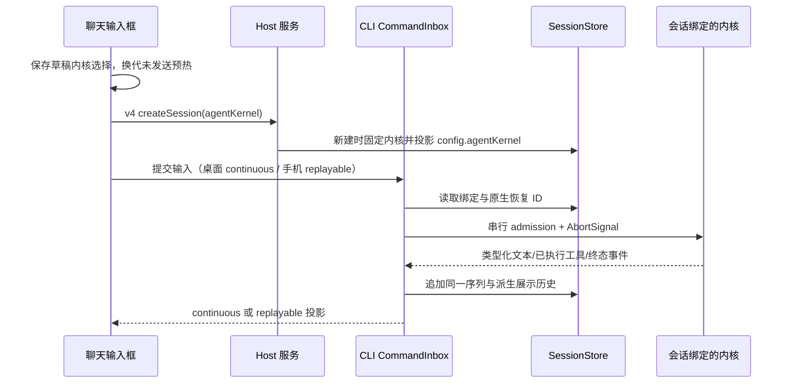

# Agent 内核与 Claude 技能匹配

## 目标与边界

用户要求：① ZCode 内核的技能匹配规则与 Claude Code 一致；② 在聊天输入框右下角直接选择 ZCode 与 Claude Agent SDK 内核，移除设置页内核切换入口。默认未选择的新草稿为 `zcode`。Claude 内核把官方 SDK 及其配套运行时作为 ZCode 的应用依赖，在构建时准备、随应用分发；不探测或执行用户单独安装的 `claude`，不依赖 PATH、全局 npm 或外部 CLI。SDK 负责原生 Agent 循环、工具和上下文管理，不能以 Claude 模型适配器代替内核。

内核选择属于 Composer 草稿；v4 `createSession.agentKernel` 必须显式携带选择，不能依赖设置或另一条创建接口。创建会话时将内核写入会话持久化配置，并通过 v4 config 投影给 UI；缺少字段的历史会话视为 `zcode`。已有会话的选择器显示绑定内核，切换内核开启独立会话并保留未提交草稿；运行或等待审批时禁止换内核。未发送的预热会话必须在选择变化时换代，迟到 ACK 不得绑定到新选择。恢复会话必须读取原绑定，不能修改已有会话、正在运行的轮次、其工具或原生会话 ID。Claude 原生会话 ID 与 ZCode 会话 ID 分开记录，SDK 原生 ID 是恢复依据，不能靠工作区路径猜测。工作区身份继续使用 `workspaceIdentity?.trim() || workspacePath`，SDK cwd 仅用真实路径。

## 所有者与接口

- Composer Draft：未提交内核选择的唯一所有者；与正文和模型选择按 workspace identity/session scope 保存。旧 AppSettings.agentKernel 仅保持配置文件兼容，不再作为聊天创建接口的隐式权威。
- CLI Session/CommandInbox：会话绑定、输入 admission、取消、事件序列、owner/lease 和 UI 投影的所有者；两种内核复用该入口。
- ZCode 内核：拥有本仓库 Model/ToolScheduler/ContextBuilder 的执行循环。
- Claude SDK 适配器：拥有 Claude 原生循环、原生工具执行、技能目录与会话恢复；向 CLI 发送类型化的已执行事件，不能再次交给 ZCode ToolScheduler 执行。
- SessionStore：保存内核与原生会话 ID，并保存由 CLI 事件序列派生的展示历史。原生恢复失败必须报错，不能静默新建会话。
- ThinkRail：规则和技能源仍来自现有包。Claude 默认接收 `claude_code` preset，显式覆盖时只替换基础正文；只读注入始终保留。内置技能通过 SDK 本地插件目录发布，spec 工具通过受控 MCP 桥发布，子代理工具白名单/黑名单中的 spec 名称在 SDK 边界转换为同一 MCP 完整名称。
- 系统提示词设置：选择只影响编辑/预览目标，不改变聊天内核；ZCode 使用 `mainSystemPrompt`，原生内核使用 `kernelSystemPrompts[kernelId]`，覆盖基础正文并保留只读扩展。Claude 默认 preset 由 SDK 管理，未取得全文时如实提示；清空恢复 preset。无会话预览按显式内核，有会话按绑定返回，详见 [内核扩展](./agent-kernel-extension.md)。
- Claude SDK 的模型与鉴权从 ZCode 的模型配置接入，能力必须兼容 SDK 支持的接口；不要求外部 Claude CLI 的安装或登录。凭据只在请求边界注入 SDK 环境，不写进 session entry、UI 投影或日志；SDK 配套运行时缺失属于打包错误，不能退回外部 CLI 或其他内核。Main 直接解析 SDK 资源，不要求同时存在原生 zcode-agent；资源未准备时不把 undefined 放入 Electron Host 环境，默认 ZCode 的启动不受影响。

## 技能目录一致性

以 Claude Code 当前官方技能规范为依据：仅目录 metadata 预加载，正文按需读取；技能描述是匹配依据；保留所有有效名字。默认预算按模型上下文窗口的 1% 转换为字符（现有 token 估算约 4 字符/token），模型容量未知使用 200,000 tokens；兼容显式字符预算，并支持 `SLASH_COMMAND_TOOL_CHAR_BUDGET`。单项合并 description/when_to_use 上限 1,536 字符，可通过 `skillListingMaxDescChars` 配置；默认比例 `skillListingBudgetFraction=0.01`。

标准目录不再为每项附加绝对路径。超预算从调用频率低的技能开始逐项去掉描述，频率相同时按稳定规则排序；保留全部名字，不得再整份退化。显式禁止模型调用的技能不进入模型可用目录；用户显式调用仍按独立权限验证。调用统计只记录成功加载的规范化技能身份，异步持久化，不记正文、用户输入或凭据。技能设置与模型工具说明均应区分匹配目录与加载后的步骤；调用前不得凭摘要执行技能。匹配仍由模型判断，这项对齐不引入针对中文输入的关键字硬编码路由。

## UI Surface Matrix

| 场景                 | 入口                  | 所有者 / 提交                     | 隔离规则                            |
| -------------------- | --------------------- | --------------------------------- | ----------------------------------- |
| 选择本次对话的内核   | 聊天输入框右下角      | Composer Draft / v4 createSession | 显式传递；换内核新建，不改旧会话    |
| 新建 / 冷恢复 / 重连 | 现有会话入口          | CLI SessionStore / CommandInbox   | 恢复按会话绑定，保留 identity/lease |
| 查看提示词           | 系统提示词设置        | 实际目标内核只读查询              | 原生基础正文不得显示为 ZCode 正文   |
| 匹配与引用技能       | 对话输入 / Skill 工具 | 内核目录与 SkillPort              | 用户 / 插件 scope 权限保持          |

## 回归与验收

- SKL-01：目录超预算仍保留所有名字，高频技能描述保留，低频逐项裁剪；正常预算保留 FIRST；无绝对路径开销。
- SKL-02：模型窗口、显式字符预算、比例、单项上限合法性；1,024 字符以上的有效描述不应在发现阶段被丢弃。
- SKL-03：禁止隐式调用的技能不会被模型匹配；成功加载更新统计，失败不更新；插件具名身份不混淆。
- KER-01：输入框选择、草稿持久化、v4 创建参数及运行时绑定一致；无显式选择为 zcode，设置页不再提供切换入口。
- KER-02：切换内核开启独立会话并保留草稿；旧 zcode/claude 会话分别恢复原内核；原生 ID 持久化；预热换代不重放已接纳输入。
- KER-03：Claude 官方 SDK 的真实 query 调用、preset、skills、ThinkRail 注入与 spec MCP；流式文字和工具结果出现在现有时间线。
- KER-04：许可、询问（包括 yolo 下的 AskUserQuestion）、取消、连续排队输入、错误、原生恢复失败都有可观察终态。附件沿用已有不可变存储和解析，按 SDK 用户消息内容块传递，不丢失原始输入。SDK usage 投影到同一会话用量事件，并作为整轮汇总保存一次；冷恢复的回复有完成时间，供应商关联使用 ZCode 中实际选择的连接。
- KER-05：桌面 continuous 和手机 replayable 使用同一 Host attachment，不另起手机 Agent；远程 identity 隔离。
- KER-06：在无系统 `claude` 命令、无全局 SDK、无外部 CLI 登录的环境中，通过应用依赖中的 SDK/runtime 执行。macOS/Windows/Linux 按目标平台随包准备对应运行时；资源缺失与接口不兼容明确报错，不假装使用其他内核。

交互验收覆盖输入框选择、预热换代和真实 v4 新会话绑定，验收案例及本轮已完成的 279 项回归、3 项桌面 E2E 记录见 [聊天内核选择](./ui/chat-agent-kernel.md)。类型检查、Lint、架构检查和 core/bootstrap 检查必须执行并如实记录。

## 旧设置入口阶段验证记录（不代表聊天选择已通过）

- 106 项相关单测/集成测试通过：根目录 75 项，CLI 31 项；覆盖预算裁剪、规范技能计数、SDK 事件桥、附件与询问、子代理工具边界、冷恢复及系统提示词查询。
- 1 项桌面 E2E 通过：设置内核选择、持久化、工作区 SDK 预览及外部切回 ZCode 后的提示词/控件刷新。
- 真实 SDK 在隔离 HOME/PATH、无外部 CLI 登录条件下通过本地 Anthropic 接口夹具运行。确认工作流规则与 FIRST 描述进入请求，Skill 正文返回后续请求；AskUserQuestion 答案返回，spec MCP 桥执行一次。夹具验证接线，不证明真实模型每次遵守技能路由。
- 根目录类型检查、Lint（63 warnings / 0 errors）及架构检查通过；CLI contracts/adapters/core/bootstrap 类型检查和当前 Agent JS bundle 构建通过。
- 根锁文件冻结/离线校验通过。CLI 包级 Lint 仍有既有文件超过 400 行的错误；新增内核模块定向 Lint 无错误。
- 当前 Claude 的原生协议为 Anthropic Messages；其它已注册上游接口通过受控模型协议桥复用现有 Model/鉴权/重试端口。API 协议支持不代表媒体、原生搜索、精确 token 计数或 signed thinking 全部等价；无法转换时明确报错。按内核覆盖提示词及验证见 [内核扩展](./agent-kernel-extension.md)。
- 这轮未创建提交，也未生成新的 macOS 安装包。
