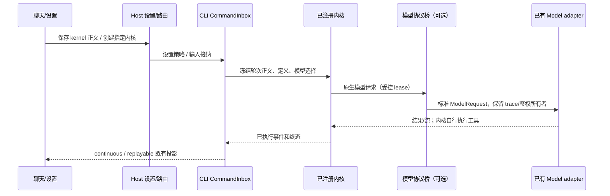

# Agent 内核扩展、子代理与提示词配置

## 已确认需求与所有者

用户要求修复新 Claude 会话被官方 visual-judge 的固定账号 Provider 阻断、Explore/explorer 重复，并让以后新增 Pi 等内核更容易。可选项按可验证实现推进：按内核查看和覆盖基础提示词；不同内核通过 ZCode 已有模型适配支持多个上游协议。

- 内核 ID/描述/能力使用共享契约，创建由 Bootstrap 的注册表和注入 factory 负责，执行通过 NativeAgentKernelPort。UI 展示已注册描述，不以散落的 zcode/claude 分支作为扩展接口；不存在或未部署的内核必须显式拒绝，不创建假 Pi 选项。
- 新内核提供 descriptor、factory 和 `NativeAgentKernelPort` 实现，可按需提供自己的资源准备；注册后同一 v4 命令、恢复存储和 UI 菜单生效。注册表从 Bootstrap 公开入口导出，不要求扩展方导入内部实现。
- CLI CommandInbox 保持输入接纳和唯一队列；SessionStore 保持内核/nativeSessionId 权威；Runtime 按已绑定实现执行，不重跑 SDK 已执行工具。Desktop continuous / 手机 replayable 复用当前 Host/事件序列。
- 子代理定义所有者仍是现有 profile 合并链。用户/项目和用户显式模型覆盖保持优先。内置重复预设按规范身份合并，旧名称作为调用别名，不作为另一份列表实体。
- 设置服务保持每内核基础正文的唯一持久化；历史 mainSystemPrompt 兼容到 ZCode。正文保存下一轮输入生效；运行中保留快照。ThinkRail、插件和会话动态注入只读，不混入用户可编辑正文。

## 官方文档插件模型

documents/pdf/presentations/spreadsheets 的 visual-judge 默认继承发起者模型/思考档位，不绑定 account:bigmodel-individual-coding-plan。package、manifest 与 official seed 版本同步更新，使已安装应用刷新官方缓存。保留用户的 pluginAgentModelSelectionOverrides，不靠忽略错误或全局关闭插件修复。视觉输入能力沿原模型能力校验；用户显式配置不存在的 Provider 仍报错。

## Explore 规范身份

基础 Explore 是唯一内置探索实体；ThinkRail 开启时补充其探索指引，旧 explorer 调用兼容到 Explore。用户/项目自行定义 explorer 不被改名或吞掉；同名自定义限制依旧优先。关闭 ThinkRail 不删除基础 Explore。UI、prompt listing、SDK agents 共享规范定义，SDK 已有原生 Explore 不重复注册另一内置 explorer。插件 canonical 与 bare alias 也不在 SDK 描述中成为重复实体。

## 可扩展内核

共享 kernel ID schema、描述和能力元数据，Bootstrap 注册表提供查找/创建/unsupported 边界，core 只依赖端口。内核恢复读取绑定，不依赖全局默认，也不能将未知绑定默认为 ZCode。增加测试内核 factory 验证注册、执行和恢复；不提前接入 Pi 实现。系统提示词查询与主循环、模型协议桥均不能依赖字符串 claude 判定所有原生实现。

## 按内核的系统提示词

设置页可选择内核，选择只影响编辑/预览目标，不改变聊天内核。ZCode 的默认正文可读；Claude 默认 native preset 由 SDK 管理，页面明确未取得全文，允许输入自定义覆盖正文，空值恢复 preset。SDK 覆盖基础正文后仍拼接只读注入并保留技能动态发现；不能把不可见 preset 冒充已完整显示。当前会话查询按实际绑定，预览按显式内核；跨窗口保存按 kernel ID 同步且拒绝迟到查询结果。

设置文件中 `mainSystemPrompt` 只属于 ZCode，其他正文存于 `kernelSystemPrompts[kernelId]`。Host 从同一设置快照读取完整策略，串行同步到本地与远端；日志对所有正文脱敏。

## 模型协议桥

Claude SDK 请求固定为 Anthropic Messages，这属于其原生协议，不通过简单放宽接口校验伪称支持其它协议。若接入桥，SDK → loopback Messages endpoint → 已有 Model port/Provider Registry → 上游协议。桥只执行模型调用，不创建第二个 Agent/tool loop。Model adapter 仍拥有真实鉴权、网络/代理/重试/日志；SDK 不得到上游凭据。

每次执行持有独立桥 lease：随机授权 token、loopback 监听、冻结 model selection/trace、AbortSignal；仅开放 Messages 与 count_tokens 路径，count_tokens 在无法提供精确计数时返回 501，不伪造；有界 body/严格 schema/工具和媒体转换；不监听公网、不记录正文或凭据。请求取消、SDK异常、正常终态都关闭连接/释放 server。工具名、ID、结果与流式 stop reason 保真，拒绝无法转换的内容，不伪造工具结果、thinking signature 或计费。

模型能力不能等同于接口支持：上游仍必须支持当前任务所需工具或媒体。按已有 modelFactory 支持的 API 类型验证，主子代理的明确选型经注册 alias 路由，保留原生会话绑定与单一输入队列。

## 影响与验收

must-inspect：插件缓存 seed/profile 合并；shared ThinkRail/Explore 定义和 UI catalog；Bootstrap factory、SessionStore binding、core native dispatch；Settings 同步/远端策略/inspection；Provider Registry 与 Model adapter。

invariant-only：owner/lease、stale run、workspaceIdentity 隔离、SDK tool 一次执行、同一 Host attachment、两种 delivery 语义。

- KEX-01：无账号 Provider 且官方文档插件全部启用，创建 Claude 并完成首轮；visual-judge 继承当前连接；用户显式 override 仍保留并可执行/明确失败。
- KEX-02：ThinkRail 开/关、用户/项目同名配置，UI/Runtime 仅一个内置探索实体，旧 explorer 调用兼容，用户 tools 不被扩展；SDK 不重复注册原生 Explore。
- KEX-03：注入第三个测试内核，通过同一创建/执行/恢复接口，不改 UI 分支、Runtime turn switch 或持久化 schema；未知内核显式拒绝。
- KEX-04：分别保存 ZCode/Claude 基础正文，相互独立；SDK preset/自定义覆盖的边界诚实显示；ThinkRail/插件注入保持只读；运行中不变、下一轮和跨窗口刷新有效。
- KEX-05：真实 SDK 经本地非 Anthropic 上游接口完成文本→工具调用→结果→终态；工具执行一次；图片/JSON/tool result 转换、上游报错、无效 model alias、取消和 lease 清理覆盖。
- KEX-06：保持 desktop-continuous 与 web-remote-replayable 的创建/恢复绑定；旧 settings/旧 snapshot 兼容，手机不增加执行主体。

## 验证结果

- 2026-10-15：127 项单测/集成回归通过（根目录 81，CLI 46）；另有 CJS/SDK bundle 构建回归通过。覆盖官方插件继承和显式覆盖、探索去重、第三内核、两种 v4 delivery、冷恢复、正文隔离/清空/迟到查询、鉴权、工具关联、取消和 lease 释放。
- 5 项桌面 E2E 通过：3 项聊天选择和执行、2 项提示词设置。文档四插件全部启用，Claude 从聊天框首发经 OpenAI Chat Completions 回放接口完成；正文分内核保存/恢复、跨窗口刷新及只读 ThinkRail 验证通过。
- 真实 SDK 及随包 runtime、隔离 HOME/PATH：Chat Completions、Responses 两种接口均完成 2 次模型请求、1 次 Skill 执行、后续请求包含技能正文、回复与终态；自定义基座和 ThinkRail 同时进入请求，终态释放监听。主子代理独立模型回合也通过，父原生 session ID 保持一致。此处上游使用本地协议夹具，不能等同于所有真实供应商/模型的遵从率验证。
- 根 `pnpm typecheck`、`pnpm lint`（63 warnings / 0 errors）、`pnpm architecture:check --changed` 通过；CLI contracts/adapters/core/bootstrap 类型检查通过。新增注册表、native 入口与 SDK/协议桥模块定向 Lint 无错误。
- CLI 包级 Lint 已实际执行，仍被既有 `max-lines` 超限阻断，涉及 contracts/workflow、bootstrap/v4-gateway、adapters/storage 等文件；未记为通过。
- 可转换接口不保证全部供应商特性等价：工具/媒体以具体模型能力为准；拒绝无法表示的内容，不提供假的精确 token 计数，不把 SDK 按 Claude 定价计算的费用显示成桥接上游的真实费用。

本轮完成源码和验证，未创建提交，未更新 macOS 安装包。
