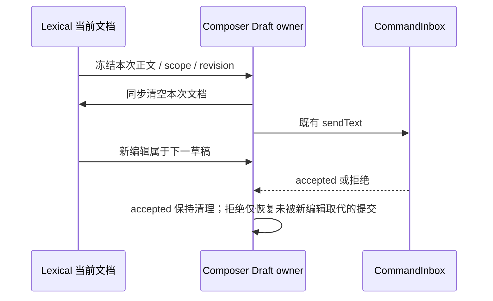
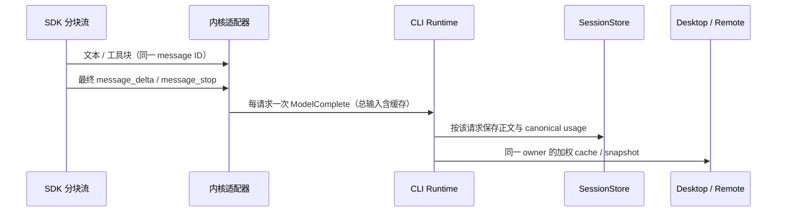

# Composer 提交清理与原生内核缓存用量修复

## 范围与影响

| 项目        | 决策                                                                     |
| ----------- | ------------------------------------------------------------------------ |
| 模式 / 层级 | implementation；commit-effect、persistence、recovery                     |
| 入口        | Desktop 与 Web 共用 ConversationComposer；原生内核协议桥与 context usage |
| 既有规范    | task-scoped-composer-drafts.md、context-cache-hit-rate.md                |
| 非目标      | 更换 Agent 循环、保证上游缓存命中率、自动重试消息、改变用户模型配置      |

| UI 场景                    | 共享实现                                                | 状态所有者                                      | 提交 / 落点                | 隔离                                       |
| -------------------------- | ------------------------------------------------------- | ----------------------------------------------- | -------------------------- | ------------------------------------------ |
| 首发、后续发送、运行中排队 | Composer / ChatPromptEditor / LexicalChatInput          | 现有 Composer Draft owner；编辑器只持有当前文档 | sendText；既有草稿存储     | workspaceIdentity、session scope、提交代次 |
| 缓存面板 / live 与恢复     | NativeAgentPort → CLI ModelComplete → ProductProjection | CLI runtime 的主会话用量累计                    | 同一事件序列、SessionStore | 主会话与子代理 / sidecar                   |

必须检查：编辑器清空与快照读取、首发 promotion、失败恢复、新输入保护、附件 adoption、SDK 分块、协议桥缓存控制、live 与 cold usage。测试与静态调用只作为证据。剪枝：不枚举主题/国际化（无展示文案变更）；不改变 Host routing / 两种 delivery 的恢复语义。

## 提交契约

- 有效提交并完成附件就绪校验后，同一提交占用原草稿、清空对应可见正文。等待确认期间显示可编辑的下一条草稿。
- 同一提交绑定来源 workspace/session 与正文 revision；新的真实输入不能被旧 ACK、失败回包或程序性更新覆盖。
- failed、blocked、confirmationRequired 时，若没有新编辑，恢复冻结的正文与 Lexical JSON；有新编辑时保留新草稿。
- Lexical 的 clear 必须在返回时使 getMarkdown/getEditorState 与文档一致，不能让 blur/pagehide/promotion 持久化旧 JSON。
- 编辑器的程序性更新与通知必须按当前文档事实交付；旧文档通知不能重新写回已经清理的正文。真实重新输入相同正文必须被接受，禁止按字符串永久屏蔽。
- clear 与 ACK 不等待附件 adoption；已接纳输入的附件后处理失败不能把消息恢复为待发送。

## 原生用量契约

- Claude SDK 同一 message.id 的 assistant 分块属于同一个模型请求，文本与工具仍实时投影，usage 只在该请求收口时计一次，采用最终分块用量。
- message_stop、下一原生消息或 result 是收口边界；tool-result 仅在没有未完成的流式 usage 时可收口，不能抢在最终 message_delta 前结算。重复帧不能增加 requestCount。子代理消息不进入主会话累计。
- Anthropic input_tokens 为未缓存输入；ModelUsage.inputTokens 为含 cache read/write 的总输入。两方向显式换算，live、SDK result、持久化和恢复口径一致。
- 主会话 ModelComplete 复用现有 recordMainTurnCacheHitUsage，携带上下文容量与加权缓存字段；不建立第二个业务累计 owner。共用函数位于独立的 turn-cache-usage 模块，避免原生事件投影导入完整模型观测链。
- 保留 SDK 的 system/message/tool 缓存边界到 Model 契约；Chat 接口不携带不受支持的 Anthropic wire 字段。

## 验收用例（本次授权范围）

| ID     | Setup / action                                                    | Assertions / evidence                                     |
| ------ | ----------------------------------------------------------------- | --------------------------------------------------------- |
| CLR-01 | 真实 Lexical 存在已提交文本，调用 clear 后立刻读 Markdown/JSON    | 都为空；程序性通知不回填旧文档                            |
| CLR-02 | 首发 promotion / 已有会话；ACK 延迟                               | 命令等待时正文已清；accepted 后保持为空；DOM + 草稿       |
| CLR-03 | 拒绝 / 失败 / 二次确认                                            | 没有新输入时恢复原文与 JSON；新输入及改回同文保留         |
| CLR-04 | 已接纳但附件 adoption 未结束                                      | 正文不等待 adoption；附件只移交本次 IDs                   |
| NCU-01 | SDK 同一请求分为多个文本与两个工具块，工具结果与 final usage 交错 | 只一次 model-complete、最终 output tokens；文本和工具保留 |
| NCU-02 | 多请求、子代理、重复帧、最后 result                               | 每个主消息恰一次；不重复/混入；按真实请求计算 hitRate     |
| NCU-03 | Anthropic input=20/read=70/write=10                               | Model input=100；桥回转换 input=20；result 口径一致       |
| NCU-04 | system / 普通消息 / tool_result / tools 缓存标记                  | TTL 与边界保留；Anthropic wire 生效，Chat wire 无非法字段 |
| NCU-05 | desktop-continuous 与 web-remote-replayable，live + cold          | 同一用量事实与聚合；恢复不重复累计                        |

复用既有桌面内核场景加入 ACK 等待期间和真实 Lexical 快照断言。受控 SDK / Provider fixture 验证接线，不宣称提高线上缓存命中率。

## 验证记录（2026-10-15）

架构 baseline 与 ui/zcode-cli 受控上下文已读取，依赖方向按当前源码和既有契约核对。

| 验证                                        | 结果                                                                                                                          |
| ------------------------------------------- | ----------------------------------------------------------------------------------------------------------------------------- |
| UI、草稿、缓存面板回归                      | 10 文件、190 项通过；真实 Lexical 同步 clear、JSON、旧文档通知、相同新输入、发送拒绝/失败、promotion、附件                    |
| CLI 扩展回归                                | 24 文件、407 项通过、6 项失败；失败项在 HEAD 源码副本中同样复现，详见下方                                                     |
| 冷恢复扩展回归                              | 45 项通过、3 项失败；缓存聚合相关用例通过，3 项模型选择恢复失败在 HEAD 源码副本中同样复现                                     |
| 故障会话转录只读回放                        | 原始 31 条 assistant 帧归一化成 26 个 model-complete，与唯一原生 message ID 数一致；无模型请求/工具执行，不将用户转录加入仓库 |
| 真实随包 SDK / 发行版 CJS                   | 2 项通过；两个文本块和两个工具块属于一个请求，主线程两次请求正确计数；最终 input/output、cache read/write 与 SDK result 一致  |
| Desktop E2E（最终源码重跑）                 | 3 项通过；两种内核首发、Claude 连续发送、等待回复时编辑下一草稿、可见正文和 JSON 清空、重开旧会话、附件与内核切换             |
| 根目录 typecheck、lint、architecture        | 通过；lint 63 warnings、0 errors                                                                                              |
| CLI contracts / adapters / core / bootstrap | tsc build / typecheck 通过                                                                                                    |
| CLI package lint / 修改文件 lint            | 包级检查仍有既有 max-lines 错误；修改文件仅 contracts/src/model/index.ts 触发同一已有行数限制，其余无错误                     |

共有 642 项仓库单测/集成测试通过，另外 9 项扩展检查失败未掩盖。HEAD 副本复验记录位于 `/tmp/zcode-composer-cache-baseline-tests.log` 与 `/tmp/zcode-composer-cache-cold-resume-baseline.log`：

- `v4-native-attachments.test.ts`：1 项旧 createSession ACK 断言缺少已存在的 agentKernel。
- `v4-native-session-mgmt.test.ts`：4 项旧创建参数/ACK 的精确断言未包含既有内核及策略字段。
- `v4-native-boundary.test.ts`：1 项既有 v4 → 旧协议目录导入禁令失败。
- `v4-cold-resume.test.ts`：3 项既有模型/思考档位恢复断言失败；未修改这些恢复策略。

另一个动态 workflow 装配测试曾因原生缓存辅助函数静态导入模型观测链超时；抽离共享累计模块后，在原有 5 秒超时内通过，未放宽测试超时。初次 SDK 夹具缺少真实 message_start 必有的 usage 字段，已按 SDK wire 契约补齐。

上游 Chat 前缀缓存的节点/路由波动不属于本次可证明修复；没有强制 cache-key、删字段重试或模型配置回退。旧版存储记录不自动重写，新请求逐条保存 canonical usage，live 与新记录的 cold 聚合共用同一来源。真实 SDK 验证使用本地受控模型接口，不能据此承诺线上命中率提高。未提交、不打包。
