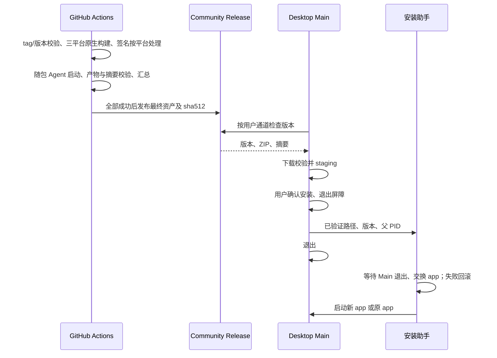

# 产品规则

- 分支名称为 **ZCode Community**。根 `package.json.version` 从 **0.1.0** 开始独立维护；tag 为 `community-v<version>`，不可复用上游 ZCode 的 3.x 版本序列。CHANGELOG 只将 community tag 作为后续发版基线。
- 正式应用 ID 为 `io.github.andrewliu83.zcode`，Preview 为 `.preview`；应用名、Linux package/executable、Windows AUMID 和 updater cache 独立于上游。既有会话／账号存储和 OAuth 兼容协议不在本轮迁移，不删除用户数据。
- 帮助菜单的版本历史同样打开本仓库的 GitHub Releases，不再展示上游版本记录。
- 更新发布源唯一为公开仓库 `andrewliu83/ZCode`。版本、tag 前缀、身份和仓库归属由入库的 distribution 配置声明，运行时更新不依赖模型／账号服务地址，不受上游最低版本强更影响。
- 默认启用更新检查，保留构建期显式关闭。正式 production 身份从本分支获取更新；独立 Preview 调试包、development、测试和 E2E 不自动请求发行源。
- 保留 Main 的更新状态机、单检查代次、取消、跳过版本、通道切换和退出屏障。更新偏好仍默认不自动下载。stable 只选正式 Release；接收 preview 时允许本仓库预发布，不允许版本降级。
- 更新请求不发送账号／设备 ID，也过滤 electron-updater 自动生成的 `X-User-Staging-ID` 灰度标识。
- 只有显式开发测试可覆盖更新 manifest；正常包固定 GitHub Provider。包内 publish 和 Main 运行时必须一致，不保留上游服务端更新入口。
- Main 在更新器加载、构造、配置和结果监听完成后才准入检查。初始化失败保留可读原因并通过既有错误结果反馈；初始化期间的请求明确返回未就绪，不能调用未配置的 fallback。单进程初始化只执行一次，失败原因保留至进程退出，重复调用不叠加监听。手动检查直接 reject 时同样恢复可操作状态，不能依赖额外的 `error` 事件结束 checking。

# 构建与发布

1. GitHub Actions 接受 `community-v*` tag 和手动构建。tag 必须与根版本精确匹配，源仓库必须匹配 distribution owner/repo；手动构建默认只上传 Actions artifacts，不自动发布。
2. 交付 macOS arm64、Windows x64、Linux x64，分别使用原生 GitHub runner。macOS 提供 DMG/ZIP，Windows 提供 NSIS EXE，Linux 提供 AppImage/DEB/RPM。Node、pnpm 使用 mise.toml 与根 packageManager，依赖只使用根冻结锁。
3. workflow 显式关闭远程资产制备，只交付本地桌面资源；Electron 下载走官方地址。Electron runtime 镜像只通过 `ZCODE_ELECTRON_RUNTIME_MIRROR` 传入 builder 配置；发行环境清空全局 Electron 镜像别名，避免覆盖 DMG 等辅助工具自身的下载源，初次 app 打包和最终 `--prepackaged` 封装使用同一隔离环境。`--plan` 仅展示无凭据的下载配置，不输出完整环境。独立终端 SEA 和远程 server runtime 不在本次 Release 资产范围内。
4. `bundle:desktop -- --app-only` 只产出应用目录并检查运行时依赖；在签名前写入 `Resources/app-update.yml`（固定 Community GitHub 源及独立缓存），发布校验必须读取并核对该文件。签名后才压缩最终安装包，避免重复压缩。无证书时：构建 `.app` → 独立 ad hoc 签名 SDK 与原生资源 → 签整个 app → 严格校验 → 重新生成 DMG/ZIP/更新清单 → 校验 sha512 → 上传。
5. 有完整 Apple 证书及公证凭据时：自动导入临时 keychain、签名并公证／staple，随后生成最终资产。凭据配置不完整必须失败，不能无声降级；清理临时 keychain 和凭据文件。
6. 三个平台各自校验最终产物、平台更新 YAML、blockmap 与 sha512。汇总任务要求三个平台齐全、版本/tag/commit 一致，并重新验证全部摘要，拒绝资产重名；不能通过平铺下载覆盖各平台的校验文件。全部成功后才创建 draft、上传并公开同一个 Release；任何平台失败均不发布。tag push 自动发布，手动构建只上传 artifacts。
7. Windows 默认生成未配置 Authenticode 的 NSIS 包，不依赖原库的企业签名服务。Linux 由 runner 安装公开的 RPM/FUSE 打包依赖，不发布 Arch 包。各平台只有一个首期架构，更新 YAML 分别为 latest-mac.yml、latest.yml、latest-linux.yml。
8. Windows 更新沿用 NsisUpdater；Linux 按安装格式沿用 AppImageUpdater、DebUpdater 或 RpmUpdater，DEB/RPM 安装遵循系统授权，不自行增加提权实现。各平台更新均使用 Community GitHub Provider，不得跳转上游更新服务。Linux 各格式串行封装，先生成无 package-type 的 AppImage，再由 DEB/RPM 写各自标记，最终合并同版本更新清单；不能让共享资源目录并发改写包格式。
9. 每个平台在封装前用随包 Electron Node 执行 Agent `--version`，使用临时数据目录且不发送模型请求，60 秒内不能成功启动就停止发行。汇总要求每个平台有启动验证记录，不能只验证安装包文件存在。
10. Gen UI 清单覆盖的固定运行资源、vendor 与许可按仓库原始字节 checkout，Windows 的 `core.autocrlf` 不得改写；构建继续使用原始 SHA256 校验，不在校验前归一化内容或重写摘要。
11. 安装包名称使用已解析的目标架构 `x64` / `arm64`，不使用宿主架构，也不由 electron-builder 的格式宏改为 `x86_64` / `amd64`。builder、更新清单、单平台验证与汇总使用同一规范名称；DEB/RPM 包内部的架构元数据仍由各格式的原生打包器负责。
12. Windows NSIS 阶段补丁由 `artifactBuildStarted` 在 `nsis` / `nsis-web` 编译前应用，覆盖普通构建和独立 `--prepackaged` 进程；不得依赖只在应用目录打包时运行的 `beforePack`。同进程重复事件幂等，进程退出恢复上游模板原字节，安装器与卸载器均保留 warnings-as-errors。
13. macOS ad hoc 更新器的 `electron-updater`、`builder-util-runtime` 保持外置运行时依赖，不把其 CommonJS 实现内联到 ESM 动态 chunk。回归必须实际构建生产 ESM 并在真实 Electron 中加载、构造和检查本地更新源；仅替换 AppUpdater 的单测不足以证明可用。

# macOS 安装边界

- Developer ID 包可复用 Squirrel.Mac；ad hoc 包使用本分支的受控 ZIP 安装器，不能把 Squirrel 的校验失败当成功。
- ad hoc 下载复用 electron-updater 的 GitHub Provider、版本检查、缓存和事件。下载必须校验清单 sha512；解压前拒绝越界条目；解压后校验代码签名、bundle ID、目标版本和目标架构。
- 安装只替换当前 Community `.app`。拒绝原版 app、DMG／AppTranslocation／只读目录、损坏 ZIP、错误版本和错误身份。不得申请静默提权或改变系统 Gatekeeper。
- 下载／校验／staging 完成后才能发 ready。staging 位于目标同一父目录，权限隔离。Main 先停止 Host/Agent，再启动独立安装助手并退出；助手确认 Main 退出后分步重命名替换 app，失败回滚原 app，记录本地日志并重新启动。
- 安装助手用参数传递路径，不拼接 shell 代码；helper 幂等、超时不替换、失败保留原 app。没有可写安装位置时清晰提示手动安装。
- 旧 `ZCode Preview 3.15.1` 需要手动安装第一份 Community 包，之后按 Community 版本更新；不会强行降级或覆盖原 app。

# 验收

| ID    | 场景          | 断言                                                                                            | 证据                                |
| ----- | ------------- | ----------------------------------------------------------------------------------------------- | ----------------------------------- |
| CR-01 | 版本与身份    | 0.1.0、community tag、独立 appId/name/cache；上游 tag 不能触发发行                              | unit / workflow validation          |
| CR-02 | GitHub 更新源 | 账号 endpoint 不影响 repo；stable/preview/关闭检查符合设置，未发布时报告无可用发行              | unit / provider integration         |
| CR-03 | 无证书发包    | 真实 arm64 app 严格签名通过；DMG/ZIP/YAML 指向签名后产物                                        | local build / digest validation     |
| CR-04 | 下载安全      | 损坏校验、错误版本/身份/架构、越界 ZIP 均拒绝且原 app 保留                                      | unit / installer integration        |
| CR-05 | 自动更新安装  | 测试 app 从 0.1.0 更新为 0.1.1；等待退出、重启；交换失败回滚                                    | filesystem/process integration      |
| CR-06 | 更新 UI       | 检查、下载进度、ready、取消和重启仍沿用 Main 状态机                                             | existing regressions / desktop E2E  |
| CR-07 | Apple 配置    | 无凭据走 ad hoc，部分凭据失败，完整凭据走 Developer ID+公证；不在日志输出凭据                   | unit / CI when secrets configured   |
| CR-08 | 隐私及隔离    | 无旧上报依赖，无上游强更，无凭据随包，原安装与业务会话不被删除                                  | scan / unit                         |
| CR-09 | Windows 发布  | 原生 x64 runner 构建 NSIS、latest.yml；身份和更新缓存独立，manifest 摘要与 EXE 一致             | native CI / release script tests    |
| CR-10 | Linux 发布    | 原生 x64 runner 构建 AppImage/DEB/RPM、latest-linux.yml；三种包可从同一更新目录选到匹配格式     | native CI / provider integration    |
| CR-11 | 多平台汇总    | 缺平台、版本/commit 不一致、摘要损坏或同名资产均阻止发布；合法三平台产物可合并                  | artifact integration                |
| CR-12 | 跨平台命令    | 原生 host/arch 不匹配先失败；Windows pnpm shim 与目录边界合法；macOS 签名顺序保持               | plan / command / existing Mac tests |
| CR-13 | 固定资源字节  | core.autocrlf=true checkout 后运行资源与许可仍匹配原始 SHA256                                   | temporary Git checkout / asset copy |
| CR-14 | 下载源隔离    | 继承镜像变量不覆盖 DMG 工具下载源；两次封装共用隔离环境，runtime 保持官方地址                   | release plan / real URL resolver    |
| CR-15 | 规范产物名    | 真实 builder 按三种 Linux 格式展开后仍使用目标 x64/arm64，与严格校验一致                        | builder macro / artifact validation |
| CR-16 | NSIS 最终封装 | 跳过 beforePack 后仍在 target 编译前应用阶段补丁；双侧 -WX 编译通过，退出恢复模板原字节         | artifact hook / real NSIS compiler  |
| CR-17 | 更新器加载    | 生产 ESM 的 ad hoc 动态入口在真实 Electron 中可加载、构造并完成同版本、新版本和错误清单检查     | production build / Electron fixture |
| CR-18 | 检查失败收敛  | 初始化前、初始化中、初始化失败及直接 reject 不遗留 checking；不触碰未配置 fallback 或覆盖新代次 | unit / desktop menu E2E             |

# 影响说明（Impact Brief）

- 模式：planning / implementation；层级：validation、commit-effect、recovery、发行配置。
- Primary seeds：resolveDesktopProductIdentity、collectBuildMetadata、initAutoUpdater、CommunityGitHubProvider、resolveCommunityUpdater、prepareCommunityMacUpdate、runDesktopProductionBuild。
- UI Surface Matrix：帮助菜单／设置下载偏好／更新弹窗复用现有平台 IPC；显示投影归 UI，下载、检查代次和 ready 权威归 Main，跳过与偏好归 SettingService；Web/手机无独立 app updater。
- must-inspect：产品身份→打包及 Windows AUMID；版本→tag/清单；Provider→通道与 stale guard；退出屏障→安装助手。
- should-inspect：签名资源、afterPack、帮助菜单 E2E、本地日志导出。
- invariant-only：模型／账号 endpoint、conversation CommandInbox、desktop continuous/mobile replayable、workspace identity、任务用量、本地日志；均不改变所有者。
- 代码图 depth 2：tokensave 确认 identity→bundle、Provider→initAutoUpdater 的入口；脚本与 workflow 配置通过精确源码核对。现图缺少 GitHub 发行语义，是 confirmed graph delta，补入 build-release capability。
- State owner：distribution 配置持有身份/仓库，根 package 版本持有发行版本，Actions job 持有构建资产，Main 持有检查/下载状态，安装助手在 Main 退出后持有文件交换事务。
- 剪枝：不迁移既有业务存储，不改 OAuth 服务，不发布远程 runtime/CLI SEA；每个 OS 首期一个架构，暂不处理同 OS 多架构清单合并；不伪称 Apple 无证书公证可用。
- 待定用户问题：无；采用独立 Community 默认名和 0.1.0，证书缺失时支持 ad hoc。
- E2E handoff：复用 Main 更新状态机回归，帮助菜单验证 Community 版本历史和 Preview 更新禁用；本地 Provider/ZIP/进程夹具及真实 Electron 探针不访问线上 Release，不安装到真实用户 app。

# 验证结果

- macOS 首期验证：188 项更新、下载、安装、身份、菜单及既有状态机测试、9 项构建配置／发布脚本测试通过。
- Windows/Linux 扩展：127 项更新器／身份／跨平台命令回归、20 项构建配置和多平台汇总测试通过。包含 Linux 三种格式清单合并、平台 feed 解析、缺平台、版本/commit 不一致、摘要损坏、未通过 Agent 启动验证和重名拒绝。
- 真实 macOS ZIP 验证了版本、身份、架构拒绝、等待父进程退出、文件交换和损坏签名回滚；真实 Electron 探针完成检查→下载→校验→staging→ready。夹具均在临时目录，不替换实际用户安装。
- 帮助菜单 9 项桌面 E2E 通过，包含 Community Releases URL 与 Preview 不启用正式更新。
- `pnpm typecheck`、`pnpm lint`、`pnpm architecture:check --changed` 通过；Lint 为 65 个警告、0 个错误；工作流 `actionlint` 通过。额外独立 Main TypeScript 检查仍报图标、浏览器等未修改文件的类型错误，没有将该检查记为通过。
- `pnpm release:desktop` 实际产出 Community 0.1.0 arm64 app、DMG、ZIP、更新清单、blockmap 和 SHA512 文件；最终应用严格签名、内置更新配置与 ZIP/DMG 摘要校验通过。
- 扩展后的发布入口已在本机重建 macOS 0.1.0，并用随包 Electron Node 启动 Agent（0.16.9）验证通过；产品版本与独立 Agent CLI 版本不要求相同。Windows/Linux 原生构建与安装尚未实际执行，需要首次 Actions 运行验证，不能将本地计划/清单测试算作对应平台编译通过。
- 本地验证不代表 GitHub 原生构建或公开发版已完成；在线执行结果以 Actions 和 Releases 为准。Developer ID／Apple 公证路径需要 Secrets，当前没有凭据，未计为实际执行通过。旧 Preview 3.x 需要手动安装第一份 Community 包。

## 跨平台发行阻断修复验证（2026-10-16）

- 对应失败记录为 Actions run `38852225520`（`80ef42ac`）：Windows 固定资源换行影响 SHA256；macOS 全局 Electron 镜像污染 DMG 工具下载源；Linux 格式架构宏与规范文件名不一致。
- 新增回归先复现失败，修复后发布脚本 17 项、桌面构建/资源 15 项通过。真实 Git `core.autocrlf=true` checkout 保持资源原始摘要；真实 `@electron/get` URL 解析保留 DMG 工具自身源；真实 builder 展开覆盖 Linux x64/arm64 的三格式及 macOS/Windows 目标。固定资源测试已纳入根 Vitest 默认发现范围。
- 根 `pnpm typecheck`、`pnpm lint`、`pnpm architecture:check --changed` 通过；Lint 为既有 65 个警告、0 个错误。本次修改文件的定向 Lint 无警告，格式和 diff 空白检查通过。
- 本机 Node 24.14.0、pnpm 10.33.2、macOS arm64 执行完整 `pnpm release:desktop -- --os mac --arch arm64`，输出隔离在 `packages/desktop/dist/verification-community-release-portability/`。DMG、ZIP、blockmap、更新清单和 SHA512 全部生成，ad hoc 严格签名、运行时依赖与随包 Agent 0.16.9 启动验证通过；修正后的 DMG 工具官方地址 HTTP 200。
- 本轮未在 Windows/Linux 原生系统执行打包，未运行 UI E2E，未触发 GitHub Actions、提交、推送或发布。契约回归不代替这两个平台的原生发行结果。

## Windows 最终 NSIS 封装修复验证（2026-10-16）

- Actions run `38865371294`（`community-v0.1.1` / `ec44bdfc`）的 macOS arm64 和 Linux x64 已完成原生构建、随包 Agent 启动验证和资产上传；此前镜像与文件名问题均已消除。Windows 应用目录和 Agent 启动也通过，最终 NSIS 安装器因 `ZCodeResetUninstallerLog` 未引用的 6010 警告停止，汇总发布被跳过。
- `--prepackaged` 跳过原 `beforePack` 补丁入口；补丁已移至真实 NSIS target 编译前的 `artifactBuildStarted`，保留 `-WX`、同进程幂等与退出恢复，不改安装、卸载及所有权清理行为。
- 真实 NSIS 编译回归先复现同一条 6010，再验证 `nsis` / `nsis-web` hook、安装器/卸载器严格编译、上游模板隔离与恢复。发布脚本 17 项及桌面相关 19 项通过；2 项仅 Windows 可执行的安装行为测试在 macOS 跳过。根 typecheck、lint（65 个既有警告、0 错误）、架构、格式与 diff 空白检查通过。
- macOS arm64 用隔离的小型 PE 载荷调用真实 electron-builder `prepackaged` 流程，安装器/卸载器均编译成功并生成 EXE、blockmap 与更新清单；进程退出后上游模板 SHA256 与运行前完全相同。该验证不是完整产品发行包，也未执行 Windows 安装器。本轮未重新推送、移动标签或触发发布。

## macOS 更新检查挂起修复验证（2026-10-16）

- 0.1.2 实际安装包的 ad hoc 更新器动态 chunk 在 Electron 中报 `Dynamic require of "events" is not supported`；初始化未注册结果监听，手动检查因而无法收口。`electron-updater`、`builder-util-runtime` 已显式外置。
- 回归先复现缺失外置配置和真实 ESM 动态加载失败；修复后 8 个文件共 146 项更新相关测试通过。真实 Electron 41.0.3 加载生产压缩 ESM、构造实际更新器，使用隔离数据目录和本地 HTTP 源完成同版本、新版本及错误清单检查，不下载或安装真实 app。
- Main 的初始化状态阻止未配置 fallback 被调用；加载、构造或配置失败有可读日志和错误回执。初始化只执行一次；手动检查直接 reject 复用失败收敛，旧代次失败不覆盖新检查，已有可见目标仍可重试。
- 真实桌面生产构建成功。帮助菜单 E2E 的更新状态/禁用/重开（HM-02）与真实检查命令回执（HM-03）通过；HM-01、HM-04 因已移除的“问题上报／功能建议”旧菜单预期失败，未将整个套件记为通过。此 E2E 是未打包开发壳，实际 ad hoc 加载由上面的真实 Electron 构建回归覆盖。
- Node 24.14.0、pnpm 10.33.2 下根 `pnpm typecheck`、`pnpm lint`（65 个既有警告、0 错误）、架构检查（0 违规）、格式和 diff 空白检查通过。独立代码复核无可操作问题。本次不改版本、不提交推送、不替换本机 app、不发布新安装包。

# 使用方式

- 在对应原生系统执行：macOS `pnpm release:desktop -- --os mac --arch arm64`；Windows `pnpm release:desktop -- --os win --arch x64`；Linux `pnpm release:desktop -- --os linux --arch x64`。输出分别在 `packages/desktop/dist/community/macos-arm64/`、`windows-x64/`、`linux-x64/`；添加 `--plan` 仅查看配置，不要求当前主机匹配目标。实际构建在清理目录前验证 host/arch，拒绝跨平台错配。
- 当前发行版本为 `0.1.4`：提交并推送源码后，创建指向该提交的 `community-v0.1.4` 标签。Actions 自动构建并发布；在 GitHub Actions 中手动运行则只上传 artifacts。重跑旧标签仍构建其原始提交，修复后递增根版本并创建新的 `community-v…` 标签，不移动旧标签；也可使用 `pnpm release patch`／`minor`。
- 工作流的矩阵从 `scripts/community-release-targets.mjs` 读取：macOS 使用 `macos-15`（arm64），Windows 使用 `windows-2022`（x64），Linux 使用 `ubuntu-22.04`（x64）。Linux 安装 rpm、libfuse2、patchelf；Windows 启用长路径。所有 runner 只使用根冻结锁。
- macOS 无 Apple 凭据时无需配置 Secrets，走 ad hoc。正式签名需同时配置 `MACOS_CERTIFICATE_P12_BASE64`、`APPLE_SIGNING_IDENTITY`（Developer ID Application 完整名称）、`APPLE_ID`、`APPLE_APP_SPECIFIC_PASSWORD`、`APPLE_TEAM_ID`；加密 P12 另设 `MACOS_CERTIFICATE_PASSWORD`。进入正式签名后保持签名身份稳定。凭据不完整时失败。
- 下载构建 artifacts 时保留每个平台目录，由 `scripts/collect-community-release.mjs` 校验并汇总为一份 SHA512SUMS、构建记录和发行说明。三个平台全部成功才上传 draft，全部资产上传后才公开；已发布版本不覆盖，修改内容必须递增版本。Windows 当前未做 Authenticode 签名；DEB/RPM 更新沿用系统授权安装。
- 用户先把 Community `.app` 移到可写的安装位置。默认只检查并提示，保留自动下载偏好；下载验证后可重启更新。旧 Preview 3.x 不自动降级为 Community 0.x。
