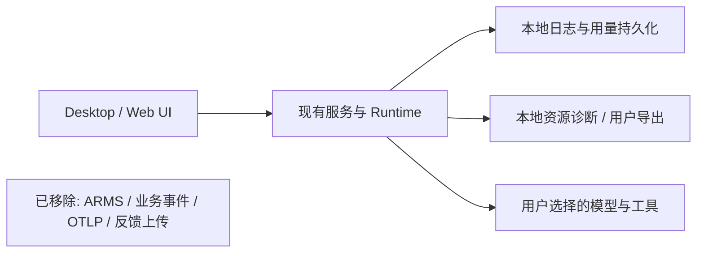

# 产品规则

用户授权删除以下能力，而不是仅关闭开关：

1. ARMS RUM 的性能、错误、点击、网络、资源和崩溃上报：移除 SDK、自动注入、collector、上传桥及专用构建配置。
2. 业务事件埋点：移除事件发送服务、客户端调用、心跳与会话事件上报入口，包括内容型推荐提示词埋点。
3. Agent OTLP：移除 exporter、外部 OTel SDK 依赖、CLI/Host 启动与关闭装配、构建注入和导出环境变量支持。
4. 用户反馈上传：移除反馈工单、评论、附件、截图和日志上传服务、后台上传／重试任务、RPC/平台入口与产品界面。

历史数据不删除、不上传、不迁移；旧配置里的上报地址不得重新启用已删除能力。不以空服务或全局 no-op 兼容层保留被删除的产品接口。

## 范围与必须保留的能力

保留本地 logger、trace 关联、模型输入／输出／缓存用量和成本统计、App Usage、本地资源诊断及导出日志；它们不得依赖远程上报 sink。进程崩溃恢复、退出日志和故障预算继续有效。正常模型、MCP、插件、远控、登录和会话分享保持各自现有授权边界；本次不新增任何数据接收方。会话内本地评分如仍用于会话事实，可保留本地持久化，移除其事件上报。

## 所有者与边界

- CLI Runtime 继续拥有会话、输入队列、用量和事件序列；清理不得改变两种 v4 delivery、owner/lease、恢复和取消语义。
- Main/Host 只保留本地日志和本地诊断装配，删除上传 IPC、远程上报中继、启动心跳及凭据注入。
- services、shared 删除已移除的业务接口、验证 schema 和服务注册；UI 不再请求或展示已移除功能。
- 构建脚本仍拥有自动更新等独立设置，不再解析或内置 ARMS、事件上报和 Agent OTLP 配置。
- 依赖安装统一使用仓库根 workspace 和根锁文件；移除已经无法独立安装的 CLI 嵌套 workspace 与旧锁，避免其中继续保留废弃 exporter。CLI 子目录命令继续解析根 workspace；聚合命令通过相对目录筛选 CLI 包及其依赖，以递归 pnpm 执行，不能依赖已移除的嵌套 Turbo 根或递归调度聚合包自身。不恢复已经移除的内部模块。
- Claude SDK 的环境与最高优先级 settings 均禁用遥测和错误报告；项目设置不得重新打开已删除的上报能力。

## 界面与影响矩阵

| 场景                 | 入口 / 事实所有者                     | 新行为                             | 隔离边界                                           |
| -------------------- | ------------------------------------- | ---------------------------------- | -------------------------------------------------- |
| 启动、日活、操作事件 | Desktop Main / UI / telemetry service | 不创建 collector、心跳或发送事件   | 登录与工作区就绪仍正常                             |
| 工具、会话与模型事件 | CLI / Host / UI                       | 本地用量与状态保留，远程 sink 删除 | desktop-continuous 与 web-remote-replayable 均保留 |
| 反馈导航、工单、上传 | UI / feedback service / platform      | 产品入口、RPC、后台任务删除        | 本地导出日志与主动会话分享保留                     |
| 构建与独立 CLI       | build config / bootstrap              | 旧上报环境值不启动出口，不分发依赖 | Windows/macOS/Linux 与两种内核                     |

## 验收场景

- 桌面和 Web 可以启动，菜单和设置无反馈上传页面或失效链接，普通聊天、工作流与插件页面仍可使用。
- 配置历史 ARMS、业务事件、OTLP 环境变量时，不加载被删除 SDK、不发出这些上报请求；构建不存在相关必填要求。
- 用户反馈服务、工单和上传 IPC/RPC 不再注册，截图／日志上传任务不存在；本地导出仍工作。
- ZCode 与 Claude 的请求计数、token、缓存率以及恢复后的用量不因清理而丢失或重复。
- 守护进程、Host、Main 的退出与崩溃恢复仍保留本地日志；不会等待上报 flush。
- 源码与构建产物不再包含被删除 SDK/exporter/上传端点装配；锁文件不再直接依赖移除包。

## 验证计划

先补公共服务/构建无上传出口、UI 无反馈入口及本地用量保留的回归；运行根 typecheck、lint、architecture，以及 CLI 受影响包检查。交互变更执行可用的 Desktop E2E，分别验证桌面连续链路与手机可恢复链路的相关契约。删除只验证已删除实现的旧测试，保留并修正混合业务测试，不以移除断言隐藏业务回归。

## 影响扫描与后续记录

分类：presentation / commit-effect / persistence / recovery。must-inspect：Desktop bootstrap/preload/Host、services registry、CLI telemetry exporter/bootstrap、shared telemetry/feedback contracts、反馈导航和埋点调用。invariant-only：模型接入、缓存统计、会话分享、App Usage、本地导出。没有需要用户再次裁决的产品范围；本地观测与上传的混合依赖由源码确认后拆分。

## 验证记录（2026-10-16）

| 检查                                   | 实际结果                                                                                                               |
| -------------------------------------- | ---------------------------------------------------------------------------------------------------------------------- |
| `pnpm typecheck`                       | 通过；Main/Host/preload/renderer 另由实际 Desktop 构建检查                                                             |
| `pnpm lint`                            | 通过，65 个警告、0 个错误                                                                                              |
| `pnpm architecture:check --changed`    | 通过                                                                                                                   |
| 根目录 `pnpm test:unit --maxWorkers=2` | 1,851 个文件、17,231 项通过；2 个文件和 10 项跳过                                                                      |
| 最后收尾的守护与 UI 回归               | 8 个文件、109 项通过，覆盖连接失败重试、任务归档／日志复制、闲时模板、套餐登录与发送草稿                               |
| CLI 受影响回归                         | 25 个文件、415 项通过，覆盖 Bash/Tool executor、记忆、压缩、标题、两种内核、两种 v4 delivery、用量、恢复及退出资源释放 |
| `pnpm --dir apps/zcode-cli typecheck`  | 根 workspace 的 19 个相关包通过；CLI 聚合命令不再依赖旧 Turbo 根                                                       |
| 真实随包 SDK／CommonJS                 | 2 项通过，目录和只读 ThinkRail 入口、工具分块计数、缓存输入和最终用量保持正常                                          |
| Desktop E2E                            | 帮助菜单 8 项、会话内核 3 项通过；移除上传入口后仍可导出本地日志、连续发送和切换内核                                   |
| `pnpm --filter @zcode/web build`       | 生产构建通过                                                                                                           |
| 源码、依赖与产物扫描                   | 5,286 个 JS/CJS/MJS 模块中无被删除模块及发送器标记；根锁无 ARMS、OTel SDK/exporter 条目                                |
| 冻结锁安装                             | 仓库根目录和 CLI 子目录的离线冻结锁安装均通过，无旧嵌套锁依赖                                                          |

产物扫描范围为当前构建的 Desktop Main/Host/preload/renderer、Web 和随包 Agent。Claude SDK 原生二进制未改写；其环境和最高优先级 settings 明确禁用遥测／错误上报，并清除继承的 OTLP 出口配置。

额外执行了 CLI 目录的未筛选 Vitest 扫描：11,966 项通过、108 项失败，另有 57 个 suite 加载／发现错误。该扫描混入使用 `node:test` 的 CLI/TUI 文件，不能作为统一测试入口的全绿结果。隔离的 HEAD 副本已经复现其中 84 项旧断言失败，包括模型能力、预算和文件长度断言；其余对照受到已移除的旧内部模块等装配问题阻塞，未全部认定为既有失败。未恢复旧模块、未削弱业务断言，也未将该扫描写为通过。详细输出保留在 `/tmp/zcode-remove-reporting-full-cli-tests.log`、`/tmp/zcode-remove-reporting-baseline-tests.json`。

最终检查记录位于 `/tmp/zcode-remove-reporting-release-check-*.log`；完整根测试、相关 CLI 和真实 SDK 结果位于 `/tmp/zcode-remove-reporting-completion-*.log`；桌面记录为 `/tmp/zcode-remove-reporting-verified-e2e.log`，产物清单为 `/tmp/zcode-remove-reporting-artifact-audit.json`。本轮未提交代码，未生成新安装包。
