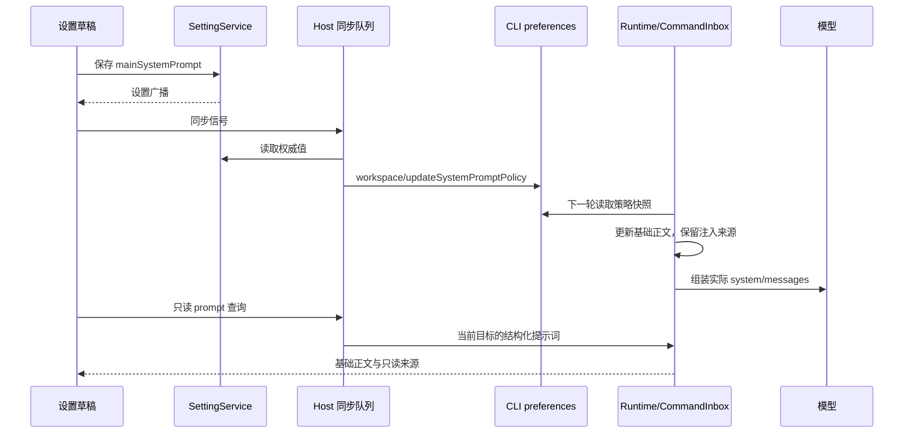

# 系统提示词设置与运行时注入显示

## 产品规则与分析证据

用户要求在设置中显示、编辑系统提示词；ThinkRail 及其他自动注入提示词按来源在独立只读区域显示。
原 ThinkRail workflow 扩展在 `before_agent_start` 中向 `event.systemPromptOptions.sections` 写入规则，
由 harness 组装到 system prompt。规则通过 `Skill` 引导模型选择工作流，不是强制调用工具的执行器。
上游现行规则对纯解释/检查允许直接执行；ZCode 当前移植规则要求新工作先读取路由。

本次只读检查本机 Model I/O，确认新的“熟悉当前项目”会话在 runtime system messages 与供应商请求体中
均包含工作流规则，`Skill` 与 spec 工具均可用，但首个响应使用文件/命令工具。该记录证明这次模型未遵守
已注入规则；不再把“未调用技能”单独作为未注入的证据。诊断只输出布尔值与工具名称，不提交真实记录。

新增设置管理主代理的基础提示词。原 CLI/子代理 `systemPrompt` 的完整替换契约仍保留；新增设置使用
`AppSettings.mainSystemPrompt`，仅替换主代理稳定行为正文，保留自动注入段。空白值恢复原配置默认正文。
保存不会改变 ThinkRail 开关、用户技能、插件、子代理 persona、权限模式或当前正在执行的轮次。

## UI Surface Matrix

| 用户场景         | UI/共享实现                               | 草稿与默认                                     | 校验/提交                                   | 权威                                  | 模式与隔离                                          |
| ---------------- | ----------------------------------------- | ---------------------------------------------- | ------------------------------------------- | ------------------------------------- | --------------------------------------------------- |
| 编辑主代理提示词 | Settings → System Prompt，Textarea/Button | 本地草稿；默认来自 AgentRuntime/ContextBuilder | 文本限制；SettingService.update + Host 同步 | AppSettings.mainSystemPrompt          | Desktop/Web；远端沿用 app-global 设置来源           |
| 查看当前注入     | 同页只读区域，可刷新                      | 不保存另一本提示词模板                         | workspace/session 只读查询                  | 实际 ContextBuilder 的结构化 sections | identity/remoteSessionId 隔离；旧结果不可串入新目标 |
| 查看当前会话     | 选择当前工作区的会话或工作区预览          | 当前运行时快照与最后一次模型请求区分           | 不发送输入、不创建 task/session             | 同一 CLI App/Runtime                  | owner/lease 与现有读取路径不变                      |
| ThinkRail 开关   | 现有设置                                  | 现有 settings authority                        | 现有同步接口                                | settings → Host → CLI                 | 不因编辑基础正文而改变                              |

## 状态所有者与事件顺序

- SettingService 是基础提示词的唯一持久化所有者。UI 仅保留未提交草稿；设置诊断日志脱敏 mainSystemPrompt，不输出正文。
- Host 读取设置，通过 workspace 级策略接口串行推送；CLI preferences 只缓存结论。
- Runtime 在 CommandInbox 的下一轮执行边界读取基础正文和特性快照，运行中的轮次冻结。
- prompt preview 是 ContextBuilder/模型请求的只读派生结果，不成为 task/session 持久化事实。
- 设置查询与首轮共用 context 初始化门；异步查询遇到 admission reservation 后不能重写运行上下文。
- Host 每次 client work 重新追平 main policy，非兼容 RPC 故障不伪装为成功；远程推送串行等待确认。
- UI 在 Host 确认后失效只读投影，工作区/服务/请求代次阻止迟到结果串入其他目标。
- 只读区展示目标当前生效的基础正文及真实 `system` / `meta_user` 注入来源，并明确角色；当前轮次或独立 server 的正文不得被 app-global 编辑草稿冒充。
- Host 的启动表面 desktop 在 wire 边界转换为 zcode_desktop，terminal 保留；严格协议参数不接受启动层枚举。
- 所有 ContextBuilder 注入来源都进入只读区；后续来源通过统一结构自然出现，不在 UI 复制常量。
- 提示词只能由当前 workspace identity 对应的服务读取；session 查询不能降级为另一个 session 或本地来源。
- Desktop continuous 与 Web replayable 复用同一设置/查询服务；不修改 stream、queue、snapshot 或 relay。

## 边界与接口

共享协议新增严格参数/结果 schema；查询带 workspacePath、workspaceIdentity、remoteSessionId 和可选 sessionId。
工作区预览不调用模型或创建新对话，明确不包含会话专用输出风格、记忆及 Hook 结果。
已有会话的查询返回 Runtime 快照，并可查看最近模型请求中的 system 内容；默认绑定当前 UI 选择的会话，
也可显式选择工作区预览或该 identity 下的 resident 会话。冷会话查询失败时由用户选择目标，不自动复活。
未支持接口的旧 CLI 显示明确的不可用状态，不以 UI 常量伪造“已注入”。

提示词编辑框与只读长文框使用固定初始高度、内部滚动并允许纵向调整大小，避免默认全文自动撑高设置页面。
基础正文和只读来源保持独立。主代理 settings override 不覆盖 workflow actor 或普通子代理。
传统 custom system prompt 的完整替换语义不因新增设置改变；预览需要如实说明其有效来源。
打开设置不能清空历史、改队列、重启进程或执行模型请求。默认正文、基础 override 与注入段由 Runtime 统一装配。

## 影响与不变量

| 分级           | 路径                                                              | 语义                                    |
| -------------- | ----------------------------------------------------------------- | --------------------------------------- |
| must-inspect   | settings/schema → Host policy → CLI preferences                   | 唯一持久化所有者与串行同步              |
| must-inspect   | Runtime → ContextBuilder → ModelRequest                           | 显示内容与实际模型输入一致              |
| must-inspect   | Settings navigation/hooks/i18n                                    | 桌面与窄屏共用 UI；草稿不被迟到请求覆盖 |
| should-inspect | ThinkRail / output style / memory / skills / project instructions | 注入来源和角色正确，独立只读            |
| invariant-only | subagent / workflow actor / legacy systemPrompt                   | 既有身份和专用提示词不被全局设置覆盖    |
| invariant-only | remote identity / continuous / replayable / queue                 | 不新增业务状态所有者，不改变交付语义    |

codegraph 已确认 ContextBuilder、AgentRuntime、createZCodeApp、SettingsPage、AppSettings 为装配和状态入口。
使用深度 2 验证调用方；源文件与接口以当前检出内容为准。功能图新增 system-prompt-settings 能力与设置入口，
连接 ThinkRail 提示词来源、settings owner 和 CLI runtime owner。

## 已接受验收场景

| ID    | 设置/动作                                | 断言                                                        | 证据                       |
| ----- | ---------------------------------------- | ----------------------------------------------------------- | -------------------------- |
| SP-01 | 默认配置打开设置                         | 显示 Runtime 默认正文、只读来源与角色；不发送模型请求       | protocol + UI E2E          |
| SP-02 | 编辑保存正文                             | 落盘；下一轮 system 含新正文，同时保留 ThinkRail/其他来源   | service + runtime + UI E2E |
| SP-03 | 恢复默认                                 | 删除/清空 override，恢复原默认正文；只读来源不变            | settings + runtime         |
| SP-04 | ThinkRail 开/关与无 spec                 | 显示实际规则；开启无 spec 仍有 workflow 指令                | request + snapshot         |
| SP-05 | 正在运行时保存，随后排队输入             | 当前轮次保留旧正文，下一轮采用新正文                        | gated runtime integration  |
| SP-06 | 远程身份相同路径、迟到查询               | 只接受当前目标的结果；不退回其他 workspace/session          | hook/service               |
| SP-07 | 子代理/工作流 actor/legacy custom prompt | 专用身份不被 mainSystemPrompt 覆盖                          | builder/runtime            |
| SP-08 | 最后一次模型请求                         | 实际 system 字符串与发给 model 的请求一致；不是 UI 拼接常量 | request capture            |
| SP-09 | Desktop/terminal 提示词查询              | 启动表面转换为 wire 值，通过严格参数校验                    | service protocol boundary  |

未定义项：无阻断实现的产品问题。采用显式保存、恢复默认和只读来源框；不加入强制调用路由或按关键词分支。
本轮修改源码与相关测试，不自动创建提交或重新打包。

## 验证记录

- 原插件：对照 `JetBrains/thinkrail` 的 `packages/pi-thinkrail-workflow/index.ts`，确认 `before_agent_start` 写入 system sections；本机真实会话的 Model I/O 只读探针确认 runtime/wire 均有 workflow 指令，首个工具调用仍为 Bash。未复制真实记录或提示词到仓库。
- 根目录相关回归：13 个文件、66 项通过；设置服务另有 32 项通过（表面转换的 2 项已计入前者，重复执行不重复计数）。
- CLI 相关回归：11 个文件、42 项通过，覆盖主正文替换/恢复、ThinkRail 与其他来源保留、执行中冻结/排队输入、workflow/普通子代理身份、只读协议查询及 identity 匹配。
- 合计 140 项不同的单测/集成用例通过。
- 桌面 E2E：`pnpm --filter @zcode/desktop test:e2e:serial --spec test/e2e/settings/settings-system-prompt.test.ts`，1 项通过。真实 UI 保存/恢复、外部设置广播、CLI 当前正文与 ThinkRail 只读来源均已验证。
- `pnpm typecheck`、`pnpm lint`、`pnpm architecture:check --changed` 通过；根目录 Lint 为 62 warnings、0 errors。CLI core/bootstrap typecheck 通过。
- CLI core/bootstrap 包级 Lint 仍有既有 `max-lines` 等错误，不标记为通过；新增独立模块没有报告对应错误。
- 修改范围格式已执行，`git diff --check` 通过。验证输出在 `/tmp/zcode-system-prompt-*.log`，E2E 报告位于 `packages/desktop/.e2e-artifacts/desktop-e2e-20261014-040122-592/summary.md`。
- SP-01/02 桌面夹具仅验证本地设置与只读 CLI 查询，不播种 ZCode OAuth JWT，避免假凭据触发真实控制面的登录过期弹窗。
- 本轮未重新生成 macOS 安装包，之前产物不包含系统提示词设置。
