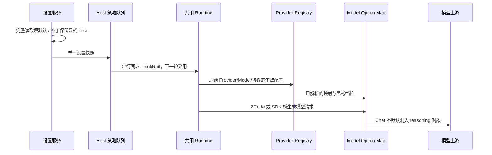

# ThinkRail 默认开启与 OpenChat 推理字段兼容

## 产品规则与所有者

- ThinkRail 是 AppSettings 的全局开关。完整设置读取时缺省为 true，新装及缺少该字段的旧配置采用新默认；显式 false 必须保留。局部设置补丁不产生默认值，保存语言等偏好不能改变开关。
- 设置服务继续唯一持久化；UI 不另建默认所有者。Host 按现有串行策略同步，下一轮生效，运行中的轮次保持快照；CLI 进程在未收到 Host 策略前仍保持既定关闭基线。
- OpenChat 指 openai-chat-completions。截图对应请求包含 reasoning_effort=max 和 reasoning={effort:max}，上游将后者按 byte[] 解码而返回 500。错误来自内置 API 兜底 Map，ZCode 和 Claude 共用，不能通过捕获错误后删字段重试来掩盖。
- 通用 Chat 兜底移除默认 reasoning 对象，保留 reasoning_effort 和现有 thinking/enable_thinking 开关；档位、输出上限、工具历史不变。Responses、Anthropic 与模型/站点/Personal 专用映射保持权威。
- 修复只更新 config/provider/zcode-builtin.json 的发布配置并递增 revision。Registry、ModelFactory、DSL 与网络发送沿用唯一执行链，不增加内核、Provider ID 或内部地址特判。OpenRouter 已有专用规则仍可发送 reasoning；不改写用户文件或已冻结的模型句柄。

## 影响与覆盖

must-inspect：AppSettings 完整/补丁 schema、SettingService 读写、TR-01 设置交互与广播；Built-in revision/缓存消费、API 兜底与专用规则优先级、真实 wire 参数、Claude SDK 协议桥。

invariant-only：内核绑定、CommandInbox admission、owner/lease、workspaceIdentity、continuous/replayable、SDK 工具只执行一次、取消及运行中快照。没有新增会话状态，复用既有 TR-01 与 KEX-05 交互场景；CLI、Desktop、Web 共享设置/参数所有者，不逐平台复制规则。

| 场景     | 输入与操作                                  | 验收                                                    |
| -------- | ------------------------------------------- | ------------------------------------------------------- |
| TDEF-01  | 新配置/旧配置缺字段                         | 完整解析与设置服务均返回 true，界面默认开               |
| TDEF-02  | 显式关闭，保存其它偏好并重载                | false 不被默认覆盖，补丁不自动带开关                    |
| TDEF-03  | 默认开后切换、外部广播关闭/开启             | 控件、持久化和目录继续一致                              |
| OCHAT-01 | 通用 Chat，低/高/max/关闭档                 | 保留对应 effort 与开关，不默认发送 reasoning 对象       |
| OCHAT-02 | 同一 Built-in 配置用于 ZCode、Claude SDK 桥 | 严格上游不因对象 reasoning 返回 500，回复与工具回合收口 |
| OCHAT-03 | Responses、Anthropic、OpenRouter 专用规则   | 维持各自合法字段与关闭语义                              |
| OCHAT-04 | Personal 显式 Map                           | 原样保持权威，源数据不被代写                            |

## 验证记录

实现前已读取截图及本地实际请求，确认混传字段。新增/修订回归先复现 3 个失败；完成实现后结果如下：

- 根目录 32 个测试文件、308 项回归通过，包含新装/旧配置缺字段、显式关闭保存重载、Built-in 解析/缓存与专用/Personal 覆盖。
- CLI 5 个测试文件、112 项回归通过，新增 prefixed GLM low/high/max 从真实 Built-in 解析后分别走直接模型请求和 Claude 模型桥；Chat、Responses、Anthropic 与 OpenRouter 的字段边界保持区分。两处仍要求旧四字段兜底的断言已按当前合同修正。
- 1 项真实随包 SDK/CommonJS 回归通过：隔离 HOME/PATH，本地上游拒绝对象 reasoning；SDK 通过实际 Built-in 配置发起两次 Chat 请求、执行一次 Read、回传读取正文并返回 OPENCHAT_OK，max 档位保持，模型桥释放，不读取外部 CLI 或线上凭据。
- 5 项 Desktop E2E 通过：2 项 ThinkRail 默认开启/切换/广播/目录场景，3 项现有内核选择/SDK 连续发送/运行门禁。
- pnpm typecheck、pnpm lint（63 warnings / 0 errors）、pnpm architecture:check --changed 通过；CLI adapters 类型检查及修改测试定向 Lint 通过。

上游验证使用严格本地协议夹具，未调用用户线上服务。未修改用户配置、创建提交或打包安装包。线上凭据与内部服务地址不进入测试或文档。
