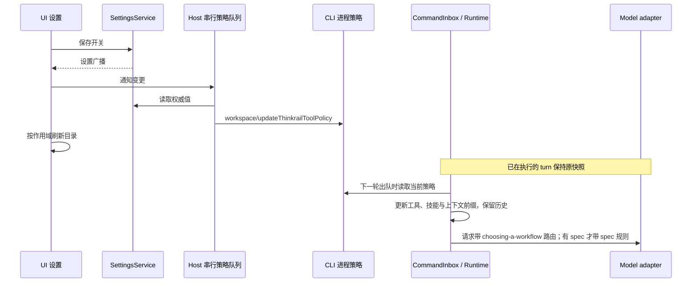

# ThinkRail 目录与提示词接入修复

## Feature Summary

| 项   | 决定                                                                                                                  |
| ---- | --------------------------------------------------------------------------------------------------------------------- |
| 目标 | 开启后能看见内置子智能体与技能；没有 spec 的项目也先经过工作流选择；已有会话下一轮采用开关新值                        |
| 层级 | option-source、validation、commit-effect、presentation                                                                |
| 模式 | planning / implementation-handoff                                                                                     |
| 起点 | SubagentsService.list、SkillsService.list、getSkillReferenceCatalog、buildThinkrailSection、updateThinkrailToolPolicy |
| 范围 | 共享目录、特性边界及模型请求中的提示词；不验收 macOS 编译产物                                                         |

## UI Surface Matrix

| 场景             | 入口                  | 来源与显示所有者                                | 校验 / 提交                              | 权威所有者                      | 模式与隔离                                                       |
| ---------------- | --------------------- | ----------------------------------------------- | ---------------------------------------- | ------------------------------- | ---------------------------------------------------------------- |
| 查看预设         | 子智能体设置页        | SubagentsService → 局部目录快照                 | 开关控制五个只读预设                     | AppSettings + 共享预设定义      | 用户/项目/插件同名优先保持；用户模型配置独立                     |
| 引用预设         | Composer @            | useSubagents → workspace context cache          | 刷新候选，不修改任务模型                 | 同上                            | identity 与 remote attachment 分桶，不从其他 Host 回填           |
| 查看内置技能     | 技能设置页            | SkillsService 复用 Agent 只读目录               | 内置项查看/引用；禁止独立启停和删除/同步 | Agent 的发现结果                | Desktop、Web 与手机通过服务访问同一 Host                         |
| 引用内置技能     | Composer skill picker | useSkills → session/workspace reference catalog | 内置 scope + readonly；开关变化刷新      | CLI runtime / 进程策略          | 保持 session authority 与 workspace fallback 的区别              |
| 发送熟悉项目请求 | 对话输入              | CLI CommandInbox → Runtime                      | 下一轮开始前读取策略                     | CLI 进程策略；本轮 Runtime 快照 | running 请求冻结，queued 输入执行时刷新；不改 stream/replay 语义 |

## Shared And Divergent Behavior

- 预设的名称、人格、工具白名单只有一个公开定义源；UI 与 CLI 投影成自己的类型。
- 内置技能不可移除，但可在目录里看见与引用；用户技能继续独立启停。
- 两条规则都指向技能，必须有 Skill 能力；spec 规则额外要求读侧工具，不再要求已存在 spec，按 DSH 机制先查图状态。
- 目录是派生快照。设置文件唯一写入方仍是 SettingsService，CLI 只接受 Host 推送。

## Feature Relationships

| 级别           | 关系                                               | 原因 / 证据                                                         |
| -------------- | -------------------------------------------------- | ------------------------------------------------------------------- |
| must-inspect   | 设置 → policy → runtime → model request            | 现有 policy 只影响新会话，旧会话缺少技能与提示词                    |
| must-inspect   | 预设定义 → CLI / SubagentsService                  | CLI 有五个预设，UI 内置名单只有两个                                 |
| must-inspect   | bundled skills → reference catalog / SkillsService | 两处原先隐藏内置技能                                                |
| must-inspect   | Thinkrail section → system prompt                  | 原先 hasSpec=false 会连同工作流路由一起删除                         |
| should-inspect | 设置广播 → UI 目录快照                             | 防止旧异步请求把关闭后的项目/Host 候选放回目录                      |
| invariant-only | CommandInbox / owner lease / replay                | 不建立第二条 admission 或改变 desktop continuous、mobile replayable |
| evidence-only  | 捕获模型请求的集成测试                             | 验证 system prompt、技能目录和工具面，而非依赖界面文字              |

## State Owners And Commit Sinks

| 事实                 | 唯一所有者                      | 投影与写入                                                             |
| -------------------- | ------------------------------- | ---------------------------------------------------------------------- |
| 用户开关             | SettingsService 的 setting.json | UI 写设置 RPC；Host 串行推送 CLI policy                                |
| 下一轮策略           | CLI appRuntimePreferences       | Runtime 在命令执行边界读取，子代理继承本轮快照                         |
| 本轮工具/技能/提示词 | AgentRuntime                    | 运行中冻结；边界更新 ThinkRail 技能族，保留用户/插件快照、历史与 lease |
| 预设定义             | 共享公开入口                    | UI 与 Runtime 只读投影                                                 |
| 技能安装事实         | Agent skill discovery           | 设置页与 Composer 只读投影，不能删除随包资产                           |
| UI 候选缓存          | UI hooks/store                  | 身份、服务与请求代次隔离；设置变化刷新                                 |

## Must-Preserve Invariants

- 用户/项目同名 profile 不扩大权限，不因关闭功能而被删除。
- 同一路径不同 workspaceIdentity 或不同 remote attachment 不共享候选结果。
- 正在执行的请求不增加/撤回工具；关闭在下一轮生效。
- Settings、Subagent model overrides、task Model 与插件冻结身份保持独立。
- 不通过 GUI 显示内核实现细节；内置项只有来源标记与可理解的只读操作。

## Codegraph Evidence / Graph Drift Candidates

| 起点                                                        | 深度 | 已确认事实                                   |
| ----------------------------------------------------------- | ---- | -------------------------------------------- |
| createThinkrailAgentProfiles → createAgentDefinitionsReader | 2    | 五个预设只由 CLI 合并，Services 没有同源目录 |
| createSkillsService → discoverSkills                        | 2    | UI 只扫描用户、项目和插件根                  |
| getSkillReferenceCatalog → toResult                         | 2    | bundled source 被过滤                        |
| buildThinkrailSection → context builder → request entries   | 2    | hasSpec 使两条规则一起缺席                   |

Thinkrail 与目录/提示词的已确认语义已补录到 feature graph。

## Graph Delta

增加 ThinkRail capability，连接 settings、subagent catalog、skill catalog、CLI policy 与 context section 的公开起点。

## Clarification Log / Boundary Decisions

用户 2026-10-13 明确要求修复目录与路由问题，并核对插件提示词注入。采用下一轮边界刷新，运行中不回收；
不以“熟悉”关键词直接强制创建 spec，分类仍由 choosing-a-workflow 技能负责。

## Dimensions / Pruning Decisions

开关：开/关；spec：有/无；会话：新建/空闲已有/running/queued/恢复；scope：主代理/受限子代理；
目录：设置/@/Skill picker；执行环境：本地/remote attachment。覆盖代表性高风险组合，不展开全局笛卡尔积。
模型选择、插件安装、stream/replay 的新语义均剪枝，保持既有不变量。

## Accepted Cases / Planning Handoff

| ID           | 条件与动作                            | 断言 / 证据                                                                          |
| ------------ | ------------------------------------- | ------------------------------------------------------------------------------------ |
| TR-CAT-01    | 开关开启，读取子智能体设置/@目录      | 五个同源只读预设出现；关闭移除；同名用户优先；服务单测 + E2E 场景                    |
| TR-CAT-02    | 开启，读取设置与 Composer 技能目录    | choosing-a-workflow 等内置技能可见；关闭移除；内置项不可独立修改；服务/协议/投影单测 |
| TR-PROMPT-01 | 开启、无 spec，发送“熟悉当前项目”     | adapter 请求 system 同时包含 workflow 路由与 spec ground-truth；完整运行时集成     |
| TR-PROMPT-02 | 开启且有 spec / 缺 Skill 或 spec 能力 | 独立按各自锚点注入；受限子代理无不可执行指令；context 单测                           |
| TR-POLICY-01 | 已有会话 false→true→false，逐轮发送   | 下一轮工具、技能和 system prompt 一致更新；历史保留；运行时集成                      |
| TR-POLICY-02 | running 时改变开关并排队下一输入      | 本轮不变，下一轮读取新值；无第二 admission；运行时集成                               |
| TR-POLICY-03 | 会话外增加用户技能再切换 ThinkRail    | 只更新内置族，保留原有用户/插件发现快照；目录查询等待本轮更新完成                    |
| TR-ID-01     | identity/服务变化时旧目录请求迟到     | 不跨目标回填；hook/store 回归                                                        |

## 提示词路径核对

上游 `packages/pi-thinkrail-workflow/index.ts` 在 `before_agent_start` 事件中把 `WORKFLOW_RULE`
写入 `event.systemPromptOptions.sections[WORKFLOW_SECTION]`，不依赖 spec 存在性。
对照源码：[JetBrains/thinkrail workflow extension](https://github.com/JetBrains/thinkrail/blob/main/packages/pi-thinkrail-workflow/index.ts)。
2026-10-13 核对到的文件 blob 为 `653a7178e87c305538b5c9832b5d601e233c87d6`。

该上游版本对项目导入、PR 生命周期及行为修改先读取路由，普通解释/检查可直接执行；
本仓库随包技能保留此前移植的更广入口（包含问题），本次按用户要求继续先读取路由，
是否进入项目初始化由技能分类决定，不按“熟悉”关键词直接创建 spec。

本仓库原路径是 `buildThinkrailSection` → dynamic system section → ContextBuilder → ModelRequest，
但原 `hasSpec=false` 提前返回使工作流指令缺席。修复后保留原规则文本，仅拆开两条规则的条件。
运行时集成捕获模型执行器收到的请求，断言无 spec 时两条规则都存在；
原生内核追加段和工作区预览使用相同条件，关闭或工具受限时仍按能力门控。
2026-10-15 对齐 DSH：移除 spec 规则独立的 hasSpec 门槛及提示词组装前探测；保留原技能路由表。
实际调用 `Skill(choosing-a-workflow)` 后的下一请求带有 `# Choosing a Workflow` 正文。
模型执行器使用不联网的测试实现，证明提示词与 Skill 工具的实际接线，不声称已验证所有模型的自主选择。

## 验证记录

- 相关单测与集成：根目录 167 项、CLI 116 项（含追加的 44 项 ContextBuilder 场景），共 283 项通过。
- 桌面 E2E：`settings-thinkrail-broadcast.test.ts` 的两项场景通过，覆盖预设/技能可见性与外部关闭后的更新。
- `pnpm typecheck`、`pnpm lint`、`pnpm architecture:check --changed` 通过；根目录 Lint 为 62 个 warning、0 个 error。
- CLI `core`、`bootstrap` 类型检查通过，修改文件格式检查通过。
- CLI 包级 Lint 未通过，仍有既有的 max-lines 错误与 warning；本轮新增或重写的主要模块的定向 Lint 通过。

E2E 使用源码测试构建与 fixture workspace，验证目录行为；没有重新验收 macOS 安装包。
本轮改动尚未重新打入先前生成的 macOS 应用包。

## 2026-10-15：常驻 spec 规则对齐 DSH

- 移除 `hasSpec` 注入门槛及 ContextBuilder、原生内核、工作区预览的事前文件探测。
  三条链路共用 `buildThinkrailSection`；Claude 继续映射原生技能名和 MCP 工具名。
- 保留开关与工具能力门控、下一轮生效和运行中快照边界；保留原技能路由表。
- 60 项 CLI 单测/集成通过，覆盖无 spec 的真实代码目录、主提示词覆盖、开关同步、
  Claude 续接、冷恢复、受限 scope 及 desktop-continuous / web-remote-replayable。
- `settings-system-prompt.test.ts` 2/2 桌面 E2E 通过，新增断言确认两种内核的只读注入框
  均有 spec ground-truth 规则，Claude 显示正确的 `mcp__zcode_thinkrail__spec_graph`。
- 根目录 typecheck、lint（63 warnings / 0 errors）、architecture 检查通过；
  CLI core/bootstrap typecheck 及修改文件格式检查通过。
- E2E 证据：`packages/desktop/.e2e-artifacts/desktop-e2e-20261015032244844-p16782-6caf3e17d2cc358a/`。
  本轮未重新生成安装包、未提交代码；测试仅证明规则接线，不代表模型必然选择建图。

## 2026-10-15：已有代码且无图时优先初始化

按用户后续裁决，路由不再完全沿用原 DSH 表：确认已有代码但无 spec 图时，
包括只读熟悉请求，都先进入 setting-up-a-project，再由该技能派发 importing-a-codebase。
常驻指针要求在判无匹配前确认图状态、查询后重新路由；条件和写入边界见 design.md D3。
搜索示例显式指定 regex=true，局部无匹配和未知 root 错误不能证明整个图为空。
技能沿既有 SDK 内容哈希资源准备流程分发，不新增独立路由状态或写入路径。

204 项 UI/领域/CLI 回归和 3 项桌面 E2E 通过；真实 SDK + 本地模型接口夹具
依次加载了三份仓库技能，4 次模型请求均完成，证明正文交付与执行接口可用。
本次同时修复 Composer 清空后被延迟草稿回填的问题；详见 ../ui/task-scoped-composer-drafts.md。
本轮未重新打包或提交代码。
