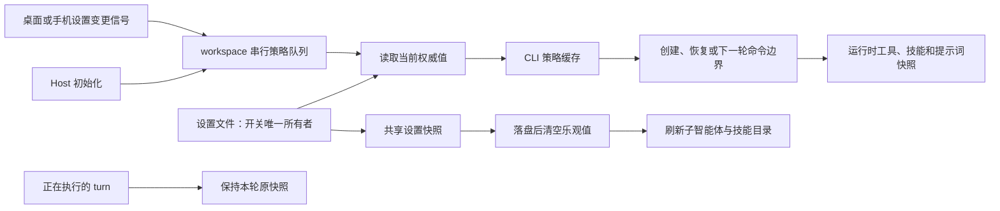

# ThinkRail（spec-graph + worktree + workflow）内置到 ZCode

> 状态：已实现 P1–P6(b)；P3（worktree）与它的面板待做
> 日期：2026-10-13
> 源：`dsh-plugin-thinkrail`（上游 JetBrains ThinkRail 的 DSH 插件移植，MIT）
> 上游：JetBrains ThinkRail（MIT）· vastsa/PI-Desktop（subagent 预设）
> 载体：**ZCode 内核第一方特性 + 单一开关**（不是插件）
> 关联：`docs/dynamic-workflow/launch.md`（同类先例）、`docs/plugins/workspace-level-plugin-architecture.md`、`CONTEXT.md`

## 0. 载体裁决

上一版方案（`docs/plugins/thinkrail-port-design.md`，已被本文件取代）决定把 ThinkRail 落成
**官方插件 + MCP server**。本版改为**内核实现 + 开关**。理由与代价如下。

### 为什么内核更对

1. **仓库已有同构先例**：动态工作流就是「独立领域包 `@zcode/dynamic-workflow` + core 条件注册
   （`registerBuiltInTools` 的 `includeDynamicWorkflow`）+ shared 特性快照
   （`packages/shared/src/dynamic-workflow-feature.ts`）+ `AppSettings` 用户开关 + UI 侧门控」。
   内核 + 开关不是新发明，是本仓库既有的第一方特性模式。
2. **插件路线被迫接受的妥协全部消失**：

   | 上一版的妥协（插件路线）                                                                          | 内核路线                      |
   | ------------------------------------------------------------------------------------------------- | ----------------------------- |
   | 常驻段只能走 hook `additionalContext`，拿不到调用方工具表，锚点判断做不到                         | 真 context section + 锚点判断 |
   | 工具名变 `mcp__plugin_thinkrail_thinkrail__spec_grep`，所有技能/规则正文要改写 + 一条 CI 检查防漏 | 裸名 `spec_grep`              |
   | 面板只能是 MCP Apps 沙箱页面                                                                      | 原生面板，可接现有 UI 组件    |
   | 工作树无法登记进 workspace（能力差异，如实记录）                                                  | 面板可直接开 workspace tab    |
   | 数据落 `${ZCODE_PLUGIN_DATA}`，布尔 `user_config` 经环境变量变字符串等小坑                        | 无                            |
   | MCP server 进程 + stdio + 清单装配                                                                | 同进程，直接读写              |

3. **`Workflow` 的 `isolation: "worktree"` 缺口**（`script-workflow-runtime.ts:282` 的
   `not implemented yet`）从「天然后续」变成「同一次实现的顺手收口」—— worktree 生命周期就在内核了。

### 代价（必须承认）

- **随 app 发布**：不能像插件那样独立迭代、不能被商店解释、不可卸载 —— 由开关承担「关掉」，
  由默认关闭承担「不打扰」。
- **UI 面板是真 UI 工作**：桌面 + Web + 手机 web、`DESIGN.md`、i18n、测试。插件路线的沙箱页面
  本来是白拿的。**这是本方案唯一显著的新增成本**，所以面板排在最后一段。
- **内核维护面**：spec 图与 worktree 加起来约 4.8k 行（源 `lib/` 4796 行），进 core 后属于
  长期维护资产；靠「独立包 + 逐函数移植」把它与 core 的其它部分隔开（见 D9）。

### 技能与预设其实不需要内核决策

`bundled-skills`（`apps/zcode-cli/packages/bundled-skills/skills/*`）与内置 subagent 定义
（`core/src/subagent/*`，如 `Explore`）都是第一方机制，与插件/内核之争无关。真正需要内核的只有
三样：**工具**、**常驻段**、**UI**。

## 1. 目标与范围

| 层          | 源（DSH）                                     | ZCode 落点                                                | 载体           |
| ----------- | --------------------------------------------- | --------------------------------------------------------- | -------------- |
| spec 面     | 7 个 `spec_*` 工具 + 1 技能 + 常驻规则        | core tool handlers + `@zcode/thinkrail` + context section | 内核           |
| workflow 面 | 8 个技能 + 路由规则                           | `bundled-skills` + 同一条 context section                 | 内核 + bundled |
| worktree 面 | 6 个 `worktree_*` 工具 + 花名册               | core tool handlers + `@zcode/thinkrail` + 原生命令面      | 内核           |
| 委派面      | 5 个具名 subagent 预设 + `thinkrail_delegate` | 内置 subagent 定义 + 现有 `Agent` 工具                    | 内核           |
| UI 面       | 右侧栏两个页签 + 设置页                       | `packages/ui` 原生面板 + 设置行                           | 内核 UI（P6）  |

**范围内**：spec 图（读/查/建/改/校验/树视图）、worktree 全生命周期（建/列/收编/改名/移除/diff）、
workflow 技能族与路由、具名 subagent 预设、spec 图面板与工作树面板、单一开关及其设置行。

**范围外**（沿用源的判断）：

- 不做独立 IDE 外壳；不替换 ZCode 的 workspace 侧栏或 Git 面板。
- 面板只读，写入的唯一路径是 agent 工具。
- 不把工作树切换成会话 cwd（ZCode 的会话 cwd 同样在创建时固定）。
- 不移植 `thinkrail_delegate`（见 D6）。
- 不移植 `pi-visualize`、`pi-todos`、`writing-workflow-skills`（上游自指的包编辑指南）。

## 2. 决策

### D1. 载体：独立包 `@zcode/thinkrail` + core 接线

**领域逻辑**（spec 解析/存储/图/查询/校验、worktree git/花名册/ref）进独立 workspace 包
`apps/zcode-cli/packages/thinkrail/`，形态对齐 `@zcode/dynamic-workflow`：无运行时依赖、
可单测、不 import core。

**工具入口与常驻段**留在 core（`ToolEntry` 类型在 `core/src/tool/types.ts`，包不能反向依赖）：

- `core/src/tool/handlers/thinkrail/*.ts` —— 13 个薄适配器，把领域结果转成工具文本；
- `core/src/context/sections/thinkrail.ts` —— 常驻段（见 D3）。

依赖方向：`core → @zcode/thinkrail`，不反向。`@zcode/thinkrail` 只依赖 `@zcode/contracts` 的类型
（若最终不需要，连它也不依赖）。

**为什么是一个包**：spec / worktree / workflow 共享同一份 spec 模型与花名册，拆开会让
`spec/index` 被复制多份。源插件也是一个包（`lib/` 下四个子目录）。

### D2. 开关：唯一所有者，默认关

| 项       | 决定                                                                                                                                                                                         |
| -------- | -------------------------------------------------------------------------------------------------------------------------------------------------------------------------------------------- |
| 形状     | `AppSettings.thinkrailEnabled?: boolean`（`packages/shared/src/protocol.ts`）                                                                                                                |
| 默认     | `undefined` 即关：新用户与老用户都不因升级得到新工具面                                                                                                                                       |
| 所有者   | `~/.zcode/v2/setting.json`（services/setting 是唯一写入方；UI 经设置 RPC 写，Host 读）                                                                                                       |
| 生效链路 | 设置文件 → Host 每次 client work 前现读 → `workspace/updateThinkrailToolPolicy` → CLI `appRuntimePreferences` → 会话 `runtimeConfig.runtimeFeatures.thinkrail` → `registerBuiltInTools` 的门 |
| 设置行   | `packages/ui/src/settings/ThinkrailSetting.tsx`（P6），先例 `DynamicWorkflowModeSetting.tsx`                                                                                                 |
| 远程/Web | desktop-attached remote Host 由 desktop 推送（`pushThinkrailEnabledToRemoteHosts`）；手机远控与 web-remote 复用同一开关，不另立                                                              |

**为什么不用 CLI config 的 `features.*` 或环境变量**（实现时在两条现成路上做过取舍）：

- CLI config 是用户手写的 `~/.zcode/config.*`，设置页的开关写不进它 —— 用了就是二次所有权；
- 环境变量把决策者挪到 main，与「设置文件是唯一所有者」冲突，而且**覆盖不到远程 Host**
  （远程 Host 读的是它自己机器的环境）。

协议推送的形状取 **Off-Peak 那一支**（单布尔 workspace 级事实），不取动态工作流那一支
（后者是「服务端提供 + 用户选择」两层，ThinkRail 没有分阶段放量的需求）。两处**有意不同**由各自语义决定：

- 关闭时也要真的推 `enabled:false`（Off-Peak 只在打开时推）—— 这里没有「服务端提供」闩住开关，
  不推的话已推到 true 的 CLI 进程会一直开着工具面；
- 新 CLI 进程以其协议缺省 `false` 为策略基线；仅在同步成功后更新已持有值。关闭基线
  不发送无变化请求，曾经开启的进程关闭时必须下发 `false`。
- 初始化与设置变更共用 workspace 串行同步队列：入队后才读取权威值并下发，后续变更
  不得在初始化之前完成，也不得被初始化的迟到结果覆盖。
- 设置控件的乐观值只覆盖未落盘期间；持久化值追上后清空乐观值，后续广播继续驱动显示。

**生效时机**：CLI 进程策略是下一轮输入的权威值。已有会话在命令队列出队、首个模型请求之前
重新读取策略；发生变化时更新工具表、自己的内置技能族和上下文前缀，保留对话历史。
用户与插件技能继续保持原会话发现快照，不因 ThinkRail 开关顺带重新纳入会话外新增文件。正在执行的 turn
不修改工具面或技能加载权限；排队输入在真正执行时采用最新策略。空闲目录查询可刷新快照，
但不得与已预留或执行中的 turn 并发改写上下文。新建和冷恢复仍在装配前读取同一策略。
v4 冷恢复没有 per-request flag 通道，因此进程缓存与 Host 的串行推送继续保留。



**开关关掉时的语义**（与动态工作流的 `disabled` 对齐）：

- 当前已实现的 7 个 spec 工具**不注册**（模型工具表为零成本）；
- context section 不渲染；
- 9 个 ThinkRail 技能不出现在技能目录；
- 5 个预设不在 `Agent` 的可用名单里（未命中会列出全部可用名，是自解释错误）；
- 面板入口消失；
- **已有 spec 文件与工作树保留**（事实在文件系统与 git，不在开关里）。

### D3. 常驻段：真 context section + 锚点判断

两条规则（spec ground truth、workflow 路由）由同一 ThinkRail dynamic section 装配
（`core/src/context/sections/thinkrail.ts`，`source: "thinkrail"`），各自使用自己的条件：

- 工作流路由：功能开启且当前 scope 可调用 `Skill`。项目没有 spec 时仍须先加载
  `choosing-a-workflow`；路由技能决定是否直接解释代码、进入项目初始化或进入其他工作流。
- spec ground truth：功能开启且具备 `Skill` 与 spec 读侧三件，不以工作区是否已有 spec 为门槛；与 DSH 一样先读取 `spec-graph` 并通过工具确认图状态。
- 子代理没有 `Skill` 或 spec 工具时，不注入它无法执行的指令；关闭时两条都不注入。

渲染位置保持在 `ContextBuilder` 的 system 层，与 `# Session-specific guidance` 相邻。
验收必须检查 model adapter 收到的请求，证明路由指令实际进入 system prompt。

**spec 锚点判断**：

```
spec 规则 = 开关开 ∧ Skill 工具可用 ∧ spec_grep / spec_get / spec_graph
workflow 规则 = 开关开 ∧ Skill 工具可用
```

spec 的锚点解决只读子代理无法调用 spec 工具的问题。与 DSH 原插件保持一致，无 spec 的空项目或
已有代码库也收到两条规则；是否已有图由 spec 工具查询结果决定，不由提示词装配前的文件探测决定。
ZCode 请求、原生内核追加段以及设置页只读预览共用同一渲染条件，不为提示词组装扫描 Markdown 文件。
工具读取仍以文件系统为事实来源，外部编辑、Git 和普通 Write/Edit 引入或移除 spec 不改变常驻规则。
初始化或首次建立规范请求由 `choosing-a-workflow → setting-up-a-project` 路由。2026-10-15 按用户要求扩展路由优先级：确认已有真实代码但没有 spec 图时，即使请求只是“熟悉当前项目”，也先进入 `setting-up-a-project`，由其继续派发 `importing-a-codebase`；不得先判只读后跳过初始化。判定 `no matching workflow` 前应通过可用的 spec 工具确认图状态，查询后来发现无图时必须重新路由。

图是否存在以 spec 工具事实为准：一次搜索无匹配或无效 root 的报错不能单独证明整个图为空；使用无内容过滤的规范查询确认。普通 Markdown 文档没有图节点所需 frontmatter 时可以作为导入材料，不能凭文件名当作已有图。进入工作流不等于授权覆盖文件，仍遵循导入技能的意图澄清、审阅与用户明确的只读限制。已有图沿原路由处理，不重复初始化；功能关闭和受限 scope 不增加工具或无法执行的规则。

此项是 ZCode 的明确产品规则，优先于原 DSH 技能允许直接只读熟悉的缺省分支；所有内核复用同一技能资产，常驻指针提醒先确认状态及重新路由，Host 不新增 onboarding 状态或另一条写入路径。

验收覆盖：已有代码/无图的熟悉请求、已有图、空仓库、搜索局部无匹配、无效 root、运行中开关冻结、外部 spec 创建/删除；同时核对 ZCode 实际模型请求和 Claude 追加段与 Skill 正文交付。

2026-10-15 验证：路由正文与常驻提醒的请求层测试先红后绿，CLI 相关 26 项回归通过；真实 Claude SDK + 本地 Chat Completions 夹具完成 4 次请求和 3 次 Skill 调用，依次读取仓库真实的 choosing-a-workflow、setting-up-a-project、importing-a-codebase，且模型桥终态释放。该夹具验证技能可执行及正文交付，不声称证明真实供应商模型必然遵循路由；工作流仍通过共享提示词与技能执行，没有新增按关键词强制调用的 Runtime 分支。

**规则原文**（工具名用内核裸名，去掉源插件的 MCP 前缀）：

```
Specs are this project's ground truth.
- Before you explore the codebase, plan, start a task, or add/change a feature, FIRST read the
  spec-graph skill, then use spec_grep / spec_get / spec_graph to find and read the relevant
  specs — specs before code.
- Treat their decisions and contracts as authoritative; reconcile every change against them and
  surface any contradiction instead of diverging.
- When a change alters a boundary, contract, or decision, update the spec as part of that change.
```

```
At the start of any new piece of work — a request, feature, change, fix, or fresh project idea —
read the choosing-a-workflow skill FIRST and follow it: it routes the work to the workflow skill
that governs it, or tells you none applies.
```

两条常驻规则继续引用同源技能；运行时另外从获准 bundled 快照加载必需入口正文（`choosing-a-workflow` 和能力满足时的 `spec-graph`），作为只读扩展交付。路由表和步骤只住在技能资产中，目录预算可以裁描述，但不能剥夺必需入口。SDK 名称空间映射只作用于常驻规则；技能正文通过 SDK 插件本名保持资源引用完整，不伪造工具执行。范围与验收见 `docs/agent-kernel-and-skills.md` 的“原生内核目录策略与必需入口”。

### D4. 工具面：13 个工具，裸名

| 组            | 工具                                                                                                  |
| ------------- | ----------------------------------------------------------------------------------------------------- |
| spec（7）     | `spec_grep` `spec_get` `spec_graph` `spec_create` `spec_update` `spec_delete` `spec_validate`         |
| worktree（6） | `worktree_list` `worktree_create` `worktree_open` `worktree_rename` `worktree_remove` `worktree_diff` |

- 注册走 `registerBuiltInTools` 的新门 `includeThinkrail`（先例 `includeDynamicWorkflow`），
  **只有显式 `false` 才下架**，缺席代表调用方不参与（TUI / headless / workflow child 保留工具面）；
  缺省值落在开关的 owner，不在注册层。
- 描述**收短**：facade 与写作规则搬进 `spec-graph` 技能，工具描述只留「何时用 / 关键参数 /
  一条最硬的安全约束」。动态工作流收短一次省的是每次请求的 token（见 `create-workflow-description.ts`
  的注释），13 个工具更该如此。
- 工具名裸奔的收益不只是好看：技能正文、常驻规则、预设正文里引用工具名的每一处都不需要改写，
  「移植里最容易断的一环」（源方案 4.2）与配套 CI 检查一起消失。

### D5. 技能：`bundled-skills`，随门走

9 个技能（`spec-graph` + 8 个 workflow：`choosing-a-workflow`、`brainstorming`、`writing-specs`、
`asking-user-questions`、`setting-up-a-project`、`starting-a-new-project`、`importing-a-codebase`、
`shipping-a-pr` + 它的 5 份阶段文档）
`apps/zcode-cli/packages/bundled-skills/skills/<name>/SKILL.md`，与 `dynamic-workflows` 技能同路。
技能目录的列出随开关走（先例：动态工作流关闭时 `dynamic-workflows` 技能不出现）。
随包技能在技能设置页和 Composer 的技能引用目录中可见，标为内置且只读，支持查看与引用，
不提供单技能启停、删除、同步或安装动作。设置目录复用 Agent 的只读发现结果；服务不得手写
另一份技能资产路径。`built-in` scope 与只读约束同步进入共享协议和运行时校验。
新版引用入口 `skills/referenceCatalogWithBuiltIns` 返回内置 scope；原 `skills/referenceCatalog`
继续过滤内置项。新客户端仅在 method-not-found（-32601）时回退，其他错误不更换会话权威。
技能族名称与附属文件清单由 `packages/thinkrail/src/skills.ts` 唯一维护，bootstrap 资产装配与
Runtime 技能刷新均通过公开入口读取。
设置变化使已挂载目录重新读取；请求代次继续阻止旧 workspace/remote attachment 结果回填。

`shipping-a-pr` 的五个阶段文档（`syncing.md` / `review-comments.md` / `creating.md` /
`screenshots.md` / `checks.md`）按名引用，技能正文按名读——内核侧不需要新机制。

### D6. 委派：内置 subagent 定义，不加工具

源插件的 `thinkrail_delegate` 是独立工具，因为 DSH 的 `ctx.subagents` 缝要求自己持有注册。

ZCode 已有完整 subagent 体系：`Agent` 工具带 `subagent_type`（`contracts/src/tools/agent.ts`），
`SubAgentConfig` 已支持 `tools` / `disallowedTools` / `modelSelection` / `skills` / `background`，
名字解析支持 NFKC + 小写 + 去分隔符的模糊匹配（`core/src/subagent/runner.ts` 的
`resolveAgentProfileForRequest`），未命中会**列出全部可用名**。

**决策**：探索预设合并到基础 `Explore`，另外注册 `code-reviewer` / `test-runner` / `fixer` / `ui-designer`。
开关开启时增强基础探索指引并增加四个专用预设；关闭时保留基础 `Explore`，移除四个专用预设。
共享公开入口唯一提供名称、提示词和工具白名单，CLI、Services、设置页及 `@` 目录不再列出第二个内置 `explorer`。
旧 `explorer` 仅作为调用别名；用户/项目自行定义该名字时仍优先。Claude SDK 自带的 `Explore` 不重复注册。
**不移植 `thinkrail_delegate`**：重复造会丢掉后台运行、并发、白名单执行时拒绝、子代理面板。

首次装配与每轮刷新共用 `createAgentDefinitionsReader`：先放内置预设，再应用现有用户、项目
和插件配置。非内置的同名 profile 优先，完整保留其提示词、模型与工具限制；关闭功能也不能
移除用户自己的同名 profile。

**源预设的委派引导**（`DELEGATE_STEERING`）不按原文移植：ZCode 的 Agent 工具描述已有
"When to use" 节（并行、SendMessage 续接、后台运行），工具指引归 provider 工具定义是
`system-prompt-contract` 的 Tool Boundary 要求。预设的**人格与工具白名单**照搬。

### D7. UI：原生面板（P6b，spec 图已完成）

| 源                         | ZCode                                                            |
| -------------------------- | ---------------------------------------------------------------- |
| `ctx.sidebarRight.openTab` | 右侧面板的 `spec-graph` tab（与 git / developer-tools 同一宿主） |
| 面板直接读宿主对象         | 面板经 `ISpecGraphService` 读派生快照（本地与远端同一条链路）    |
| 工作树登记为 DSH workspace | 面板可直接调 `tabStore.ensureWorkspaceTab`——插件做不到、内核可以 |

**决策**：面板用原生 React 组件，复用 `DESIGN.md` 与现有组件（`components/ui/*`、
`sidePaneTabPresentation` 的搜索/标题/图标分派）。面板**只读**，写入的唯一路径是 agent 工具。

**spec 图面板（已完成）**：

| 层         | 文件                                                                                                                   |
| ---------- | ---------------------------------------------------------------------------------------------------------------------- |
| 快照形状   | `packages/shared/src/thinkrail-spec-graph.ts`（跨进程传输的派生视图，不含正文）                                        |
| 服务       | `packages/services/src/spec-graph/{specGraph,specGraphService}.ts` + `contract.test.ts`（`ServiceChannels.SpecGraph`） |
| 客户端     | `packages/client/src/remoteServiceAccess.ts` 的 `specGraphService` 代理                                                |
| 服务注册   | `services/src/node.ts`（本地 Host）、`desktop/src/host/remoteWorkspaceServiceCollection.ts`（远端 Host 两条路径）      |
| 数据 hook  | `packages/ui/src/hooks/useSpecGraph.ts`（经 `useWorkspaceServicesResolution`，按 scope 隔离）                          |
| 面板       | `packages/ui/src/SpecGraphPane.tsx`（树 + 详情 + 问题区，只读）                                                        |
| tab 与入口 | `lib/workspaceSidePane.ts` 的 `SpecGraphSidePaneTab`（**workspace 级**）+ 加号菜单项，随开关出现                       |

三条值得记下的取舍：

- **服务而不是让 UI 自己解析**：spec 文件在宿主机器上（可能是 SSH/WSL/Docker 远端），
  解析需要真实文件系统。UI 只拿派生快照，本地与远端因此走同一条链路。
- **只读是结构性的**：`ISpecGraphService` 上没有任何写入方法，且有一条契约测试断言接口面
  只有 `readSnapshot` —— 给面板加写方法等于绕开路径闸门、frontmatter 保护与确认门三道。
- **每次现算、不轮询**：文件系统是唯一事实来源，面板是用户主动打开的；自动轮询会把一次
  仓库遍历变成每秒一次。手动刷新 + 工作区切换重读覆盖真实用法。

**工作树花名册面板**：待 P3 的 `worktree/**` 落地后再做（同一宿主，数据源是花名册而非 git）。

### D8. 数据与状态：`.zcode-thinkrail/`

| 数据            | 源（DSH）                                            | ZCode                                                        |
| --------------- | ---------------------------------------------------- | ------------------------------------------------------------ |
| spec 图         | 文件系统（派生，无持久化）                           | 同 —— **不变**                                               |
| worktree 花名册 | `${DSH_HOME}/thinkrail/workspaces.json`              | `<workspace>/.zcode-thinkrail/workspaces.json`（原子写）     |
| 工作树落点      | `${DSH_HOME}/thinkrail/worktrees/<project>/<branch>` | 默认 `<workspace>/.zcode-thinkrail/worktrees/<name>`         |
| 草稿目录        | `<repo>/.dsh-thinkrail/context/`                     | `<workspace>/.zcode-thinkrail/context/`（自带 `.gitignore`） |

花名册跟着工作区走（它描述的就是这个仓库的工作树），不再按 `$HOME` 的全局目录按项目路径分桶。
`.zcode-thinkrail/` 自带 `.gitignore`，与 `<workspace>/.zcode/` 平级但独立——配置审查与
`git status` 不互相干扰。

### D9. spec 模型：逐函数移植，不改判据

`lib/spec/**`（821 行）与上游 ThinkRail `core/` 逐函数对齐，`lib/worktree/**`（1246 行）与上游
`workspaces.ts` + `git.ts` + `diffScope.ts` + `refs.ts` 对齐。

**决策**：**原样移植，不重写**。理由：

- 不变量靠逐函数对齐维持（注释保留、字段序保留、换行风格保留三条）；
- 「是不是 spec」的判据（frontmatter 有非空 `id` + `type`）是上游语义，改它就不再是移植；
- 这部分是纯逻辑（解析/序列化/图/切片/校验/路径闸门/ref 白名单），与宿主无关。

**要改的只有宿主接口**：`sessionCwd()` 从 DSH 的 `session.header.cwd` 换成 ZCode 的会话
工作目录（领域包不提会话的概念，cwd 由 core 侧注入）。

### D10. 安全边界：全部保留

| 边界               | 源实现                                                                                   | 移植后 |
| ------------------ | ---------------------------------------------------------------------------------------- | ------ |
| ref 白名单         | `isSafeRef`（拒绝 `-` 开头、`..`、`@{`、控制字符、`~^:?*[\`、空组件、`.lock`、`.` 开头） | 不变   |
| `git worktree add` | 恒带 `--no-track` + `--end-of-options`                                                   | 不变   |
| spec 路径闸门      | `resolveSpecPath` 拒绝绝对路径 / 非 `.md` / `..` / 忽略目录 / 符号链接                   | 不变   |
| 工具失败           | 以工具文本返回，不抛异常，不把异常当控制流                                               | 不变   |
| project 解析       | `git rev-parse --show-toplevel` 恒指主工作树                                             | 不变   |

### D11. 后续项：`Workflow` 的 `isolation: "worktree"`

`bootstrap/src/app/script-workflow-runtime.ts` 现在对 `opts.isolation === "worktree"` 直接抛
`not implemented yet`，而工具描述已向模型承诺该参数。`worktree_create` / `worktree_remove`
正是实现它需要的两块。**本次不改** CLI 行为：先在 P3 把 worktree 生命周期做实，之后再让
Workflow 复用它（届时是一次独立的行为变更 + 独立验收）。

## 3. 目标结构

```
apps/zcode-cli/packages/thinkrail/                 ← 新建，形态对齐 @zcode/dynamic-workflow
├── package.json                                   ← workspace 包，无运行时依赖
├── src/
│   ├── spec/            ← 从 lib/spec/** 逐函数移植（parse/store/graph/query/validate）
│   ├── worktree/        ← 从 lib/worktree/** 移植（git/registry/refs）
│   ├── rules.ts         ← 两条常驻规则原文（字节稳定，供 core section 引用）
│   └── index.ts
└── tests/               ← 领域单测（解析不变量、图校验、ref 白名单、路径闸门）

apps/zcode-cli/packages/core/src/
├── tool/handlers/thinkrail/
│   ├── spec-tools.ts        ← 7 个 spec_* 的 ToolEntry 与描述
│   ├── worktree-tools.ts    ← 6 个 worktree_* 的 ToolEntry 与描述
│   └── index.ts
├── context/sections/thinkrail.ts   ← 常驻段 + 锚点判断
└── subagent/thinkrail-presets.ts   ← 5 个预设定义

apps/zcode-cli/packages/bundled-skills/skills/     ← 10 个技能（spec-graph + 9 个 workflow）

packages/shared/src/protocol.ts                    ← AppSettings.thinkrailEnabled
packages/ui/src/settings/ThinkrailSetting.tsx      ← 设置行
packages/ui/src/…/thinkrail/                       ← P6 两个原生面板
```

## 4. 装配点（core 侧四处，互相独立）

| #   | 位置                                         | 改动                                                                                                  |
| --- | -------------------------------------------- | ----------------------------------------------------------------------------------------------------- |
| 1   | `tool/handlers/index.ts`                     | `builtInTools` 增加 13 项；`registerBuiltInTools` 增加 `includeThinkrail` 门（只有显式 `false` 下架） |
| 2   | `runtime/helpers/runtime-tools.ts`           | 从 runtime features 解析 `includeThinkrail`，与 `includeNodeRepl` 同层                                |
| 3   | `context/builder.ts` + `dynamic-sections.ts` | 装配 `thinkrail` section，锚点用本 scope 的工具表 + 工作区 spec 根                                    |
| 4   | `subagent/`                                  | 5 个预设进可用名单，随门走                                                                            |

> 开关值到 runtime features 的传递必须覆盖三个入口：桌面 Local Host、Web/server Host、远程
> Host——与其它 settings 同一条路径，不新开通道。这是 P1 要先验证的一点（见「未决问题」）。

## 5. 状态所有权与事件顺序

```
文件系统 ─────────────────────────────┐
  spec/*.md（唯一事实来源）            │  每次读重跑遍历
                                      ▼
                              SpecIndex（派生、内存、只读、按 (mtimeMs,size) 重校验）
                                      │
                    ┌─────────────────┼─────────────────┐
                    ▼                 ▼                 ▼
              spec_* 工具        UI 面板（P6）        技能正文引用
              （模型）

git ──────────────────────────────────┐
  worktree 事实（唯一来源）           │  git worktree list --porcelain
                                      ▼
                          WorkspaceRegistry（花名册，派生 + 自有记录）
                                      │
                    ┌─────────────────┼─────────────────┐
                    ▼                 ▼                 ▼
             worktree_* 工具     UI 面板（P6）       Agent 会话 cwd
             （模型）                                （用户手工）
```

**所有者**：spec 的事实 = 文件系统；worktree 的事实 = git；花名册 = `.zcode-thinkrail/workspaces.json`
（派生缓存）。**没有双写**：不缓存 spec 内容，不缓存 git 状态，花名册只是「哪些工作树是本特性建的 /
收编的」这一条自有记录。

**关键顺序**（`worktree_create`）：

```
1. 校验 ref（isSafeRef）→ 失败即以文本返回，不碰 git
2. 校验工作树名（slug 化）→ 失败即返回
3. git worktree add --no-track --end-of-options <path> -b <branch> <base>
4. 写入花名册（原子写）
5. 播下 .zcode-thinkrail/context/.gitignore
```

3 成功而 4 失败 → 下一次 `worktree_list` 会把该工作树报成 `attachable`（git 有、花名册无），
用户可收编。**没有「先写花名册再建」的顺序**——那样会产生指向不存在目录的记录。

## 6. 验收场景

| #   | 场景                                 | 判据                                                                                                        |
| --- | ------------------------------------ | ----------------------------------------------------------------------------------------------------------- |
| A1  | 空目录（无 git）建 spec              | 能建图、能 `spec_create`、面板可见 —— **spec 图不需要 git**                                                 |
| A2  | `spec_create` → `spec_update` → 读回 | 注释、字段序、非方言字段、换行风格（含 CRLF）全部保留                                                       |
| A3  | 外部编辑器改 spec                    | 下一次工具调用看到新内容（mtime/size 重校验生效）                                                           |
| A4  | `spec_validate`                      | 报出悬挂链接、重复 id、parent 环                                                                            |
| A5  | `resolveSpecPath` 闸门               | 绝对路径 / 非 `.md` / `..` / 忽略目录 / 符号链接全部拒绝                                                    |
| B1  | `worktree_create` 全生命周期         | 建 → 列 → diff → 改名（兄弟记录一并改指）→ 移除                                                             |
| B2  | 主工作树                             | `project` 恒指主工作树，即使在链接工作树里调用                                                              |
| B3  | ref 白名单                           | `--upload-pack=…`、`@{…}`、`..`、`.lock` 全部拒绝                                                           |
| B4  | 收编 / 孤儿                          | git 有花名册无 → `attachable`；花名册有 git 无 → `orphaned`                                                 |
| B5  | `worktree_diff scope=branch`         | 与 base 的 merge-base 比，期间落在 base 的无关提交不混入                                                    |
| C1  | workflow 路由                        | 新请求触发「先读 choosing-a-workflow」                                                                      |
| C2  | 技能资源                             | `shipping-a-pr` 的五个阶段文档可被技能正文按名引用读到                                                      |
| D1  | 具名委派                             | `Agent` + `subagent_type: "Explore"` 等拿到预设人格与白名单，兼容旧 `explorer` 调用别名                     |
| D2  | 白名单是执行时拒绝                   | 预设未列出的工具**调用被拒**，不只是提示里消失                                                              |
| D3  | 锚点判断                             | 只读子代理（工具表无 `spec_*`）不出现 spec 规则；主 agent 出现（P2 ✅ 由 `thinkrail-section.test.ts` 钉住） |
| E1  | 开关关                               | 13 工具不可见、section 不渲染、10 技能不在目录、5 预设不在名单、面板入口消失                                |
| E2  | 开关关但已有数据                     | spec 文件与工作树**保留**，重新打开后照常工作                                                               |
| E3  | 无 spec 的空项目或已有代码库开着开关 | ZCode / Claude 请求和设置预览均包含 spec + workflow 规则；已有会话下一轮采用开关，受限工具 scope 仍不注入不可执行规则 |
| F1  | 面板只读                             | 面板没有写入路径；所有写操作经 agent 工具                                                                   |

## 7. 实施顺序

| 阶段 | 内容                                                                                                                                           | 依赖                |
| ---- | ---------------------------------------------------------------------------------------------------------------------------------------------- | ------------------- |
| P1   | ✅ `@zcode/thinkrail` 包骨架 + `spec/**` 移植 + 7 个 `spec_*` 工具 + `includeThinkrail` 门 + 开关传递链（设置 → Host → CLI → runtimeFeatures） | 无                  |
| P2   | ✅ 常驻段（含锚点判断） + `spec-graph` 技能 + 技能减法（开关关时不提供）                                                                       | P1                  |
| P3   | ⏸ 暂缓（用户裁决：先不移植 worktree 工具）—— `worktree/**` 移植 + 6 个 `worktree_*` 工具                                                       | P1（共用 cwd 注入） |
| P4   | ✅ 8 个 workflow 技能 + 阶段文档 + 整族技能减法                                                                                                | P1                  |
| P5   | ✅ 5 个 subagent 预设（`/thinkrail` 命令见 P5 落点说明）                                                                                       | P1                  |
| P6   | (a) ✅ 设置行与开关 UI 接线；**(b) spec 图面板 ✅**；工作树面板待 P3                                                                           | P1、P3              |
| P7   | （后续项）`Workflow` 的 `isolation: "worktree"` 收口                                                                                           | P3                  |

P1 与 P5 可并行；P6 是唯一有 UI 工作量的一段。每个阶段必须自带其验收场景（§6 对应行）与测试。

### P1 落点（已完成）

| 层      | 文件                                                                                                                                                          |
| ------- | ------------------------------------------------------------------------------------------------------------------------------------------------------------- |
| 领域包  | `apps/zcode-cli/packages/thinkrail/`（`spec/{parse,store,graph,query,validate,vocabulary}.ts` + `workspace.ts`），测试 `tests/spec/*.test.ts`                 |
| 契约    | `apps/zcode-cli/packages/contracts/src/tools/thinkrail.ts`（7 个入参 schema、共享的文字输出、工具名常量）                                                     |
| 工具    | `apps/zcode-cli/packages/core/src/tool/handlers/thinkrail/{shared,spec-read-tools,spec-write-tools,index}.ts`                                                 |
| 注册门  | `handlers/index.ts` 的 `includeThinkrail`（**显式 true 才上架**）+ `runtime/types.ts` 的 `runtimeFeatures.thinkrail` + `helpers/runtime-tools.ts` 接线        |
| 设置    | `packages/shared/src/protocol.ts`、`packages/shared/src/validationAppSettings.ts`                                                                             |
| 协议    | `packages/shared/src/zcode-protocol/index.ts`：`workspace/updateThinkrailToolPolicy` + params/result schema                                                   |
| CLI 侧  | `zcode-protocol/thinkrail-policy.ts`、`server-types.ts` 的 `appRuntimePreferences.thinkrailEnabled`、`server.ts`、`server-operations.ts` 的 `runtimeFeatures` |
| Host 侧 | `zcodeAgentService.ts`（`resolveThinkrailEnabled` / `enqueueThinkrailPolicySync` / `syncThinkrailEnabled`）、`node.ts` 注入、`zcodeAgent.ts` 接口             |
| 远程    | `packages/desktop/src/host/remoteThinkrailEnabled.ts` + `host/index.ts` 的两处推送（建连接时一次、本机开关变化后转发）                                        |
| UI      | `packages/ui/src/hooks/useThinkrailEnabledSync.ts` + `Root.tsx` 接线（设置行本身在 P6）                                                                       |

### P6(b) spec 图面板落点（已完成）

| 层         | 文件                                                                                                                          |
| ---------- | ----------------------------------------------------------------------------------------------------------------------------- |
| 领域包搬家 | `apps/zcode-cli/packages/thinkrail` → **`packages/thinkrail`**（见下）                                                        |
| 快照形状   | `packages/shared/src/thinkrail-spec-graph.ts`；`ServiceChannels.SpecGraph`                                                    |
| 服务       | `packages/services/src/spec-graph/**`（含 `contract.test.ts` 七条）                                                           |
| 客户端     | `packages/client/src/remoteServiceAccess.ts`、`packages/web/src/main.tsx` 的首页 fallback                                     |
| 数据 hook  | `packages/ui/src/hooks/useSpecGraph.ts`                                                                                       |
| 面板       | `packages/ui/src/SpecGraphPane.tsx` + `lib/workspaceSidePane.ts` 的 tab + 加号菜单 + 两处 i18n + `test/specGraphPane.test.ts` |

**为什么把领域包从 CLI 子工作区搬到根 `packages/`**：面板的数据必须来自服务层，而服务层在
根工作区的 `packages/services` —— 它**够不到** `apps/zcode-cli/packages/*`（两个 pnpm 工作区
互不依赖，这是刻意的边界）。搬家用的是 `@zcode/model-option-map` 的既有形态：exports 直指 TS 源，
由消费方的 program 直接编译。代价是 CLI 侧两处依赖写成 `link:../../../../packages/thinkrail`
（`workspace:*` 只在同一工作区内解析）。

**一处实现细节值得记下**：远端 workspace 的服务集合里，spec 图必须来自**远端** host
（`params.connectionServices.specGraphService`），不能用本地 `createSpecGraphService()` ——
后者会去读本机同名路径，存在时给出**错误的图**，不存在时给空图。两处都是错的，且都很难发现。

### P5 落点（已完成）

| 层     | 文件                                                                                                                                                                                                 |
| ------ | ---------------------------------------------------------------------------------------------------------------------------------------------------------------------------------------------------- |
| 预设   | `apps/zcode-cli/packages/core/src/subagent/thinkrail-presets.ts`（五个 profile，人格与白名单照搬源）                                                                                                 |
| 名单门 | `subagent/definitions.ts` 的 `applyThinkrailAgentProfiles`（按 `source === "built-in"` 下架）                                                                                                        |
| 接线   | `runtime/agent-runtime.ts`（首次装配）+ `bootstrap/src/app/create-app.ts`（快照刷新路径）                                                                                                            |
| 测试   | `packages/core/tests/thinkrail-subagent-presets.test.ts`（10 条）、`packages/bootstrap/tests/thinkrail-policy.test.ts`、`packages/bootstrap/tests/thinkrail-agent-overrides.test.ts`（每轮刷新限权） |

**不做 `/thinkrail` 命令**（与源插件的差异，写在这里以免下次重新论证）：源命令是
`status | specs | worktrees` 的人类可读报告 —— `specs` / `worktrees` 在 ZCode 对应 P6 的两个面板
（面板能做到命令行做不到的事：点开工作树、跳进 workspace tab），而剩下的 `status` 只是一行自述，
设置页那行已经在回答同一个问题。等 P6 面板落地后再判断是否真的还缺命令入口。

### P6(a) 落点（设置行已完成）

| 层     | 文件                                                                                                                                                               |
| ------ | ------------------------------------------------------------------------------------------------------------------------------------------------------------------ |
| 设置行 | `packages/ui/src/settings/ThinkrailSetting.tsx`（行**总是**渲染 —— 开关没有灰度层；乐观值 + 失败回滚 + toast）                                                     |
| 挂载   | `packages/ui/src/settingsPageHelpers.tsx`（紧邻 `DynamicWorkflowModeSetting`，同样 `hasServices` 门）                                                              |
| 文案   | `packages/ui/src/i18n/locales/{en-US,zh-CN}.ts`（`settings.thinkrail` / `…Description` / `….saveError`）+ `test-ids.ts` 的 `TID_SETTINGS_THINKRAIL_ENABLED_SWITCH` |
| 测试   | `packages/ui/test/thinkrailSetting.test.ts`（7 条，含保存后广播更新）；`packages/desktop/test/e2e/settings/settings-thinkrail-broadcast.test.ts`（TR-01）          |

**与动态工作流那一行的差异（根因只有一条：开关不是灰度）**：

|               | 动态工作流                                                                                       | ThinkRail                                                 |
| ------------- | ------------------------------------------------------------------------------------------------ | --------------------------------------------------------- |
| 行是否渲染    | 服务端未提供时整行不渲染                                                                         | **总是渲染**（没有「服务端是否提供」这一层）              |
| 值来源        | Host 算好的快照（提供 + 用户选择的合取）                                                         | 设置文件一个来源，直接读 `appSettings.thinkrailEnabled`   |
| 「默认」标签  | 有（要能选回跟随服务端）                                                                         | 无（没有可跟随的默认）                                    |
| 乐观值 + 回滚 | 有                                                                                               | 有（同样要，因为落盘 → Host 重发 → 下一轮工具面是异步的） |
| 设置行        | `packages/ui/src/settings/ThinkrailSetting.tsx`（无灰度层、行总渲染）+ `test-ids.ts` + 两处 i18n |

### P4 落点（已完成）

| 层       | 文件                                                                                                                                                                                                                                                                                                                    |
| -------- | ----------------------------------------------------------------------------------------------------------------------------------------------------------------------------------------------------------------------------------------------------------------------------------------------------------------------- |
| 技能族   | `apps/zcode-cli/packages/bundled-skills/skills/`：`choosing-a-workflow`（路由）、`brainstorming`、`writing-specs`、`asking-user-questions`、`setting-up-a-project`、`starting-a-new-project`、`importing-a-codebase`、`shipping-a-pr`（+ `checks.md`/`creating.md`/`review-comments.md`/`screenshots.md`/`syncing.md`） |
| 必需资产 | `packages/thinkrail/src/skills.ts` 的 `THINKRAIL_SKILL_FILES`（技能 → 附属文件）+ `THINKRAIL_SKILL_NAMES`；bootstrap 从公开入口装配                                                                                                                                                                                     |
| 技能减法 | `dynamic-workflow-gate.ts` 的 `collectThinkrailDisabledSkillPaths` 扩成**整族**：开关一关，九个技能一起下线                                                                                                                                                                                                             |
| SEA 清单 | `packages/cli/scripts/sea-bundled-skill-assets.mjs` 的必需路径补全；与 bootstrap 那份的**逐字相等**由 `bootstrap/tests/bundled-skills.test.ts` 的一条断言守                                                                                                                                                             |
| 测试     | `bootstrap/tests/thinkrail-skill.test.ts`（9 条：资产完整、附属文件一致、握手图、族外点名、宿主专名残留、开关整族下线/打开全在）                                                                                                                                                                                        |

**移植时改掉的三类引用**（正文其余部分逐字保留）：

| 源（DSH）                            | 这里（ZCode）                                            | 判据                                                              |
| ------------------------------------ | -------------------------------------------------------- | ----------------------------------------------------------------- |
| `ask_user_question`                  | `AskUserQuestion`                                        | `contracts/src/tools/ask-user-question.ts` 的工具名               |
| `web_search` / `web_fetch`           | `WebSearch` / `WebFetch`                                 | `core/src/tool/handlers/{websearch,webfetch}.ts`                  |
| `.dsh-thinkrail/context/`            | `.zcode-thinkrail/context/`                              | P1 的 `ensureWorkspaceScratchDir` 已经按这个路径播 `.gitignore`   |
| 「this plugin's `skills/`」          | 「bundled skills」                                       | 它是内核技能包，不是插件                                          |
| `writing-workflow-skills` 的技能引用 | 一句「加一个工作流 = 加一行 + 一份技能，这是第一方部分」 | 那是上游「怎么改这个插件」的贡献者指南，不在移植范围（§1 范围外） |

**P4 发现并顺手堵掉的一处隐患**：SEA 构建脚本（`sea-bundled-skill-assets.mjs`）维护着一份**独立的**
必需资产清单。两份漂移的后果不是「构建多验少验一项」，而是**运行时整包被拒** ——
`findMissingBundledSkillPackPaths` 缺任一项即拒绝整个技能包，于是连 `dynamic-workflows` 与 `/workflow`
一起消失。现在：SEA 那份补全，且相等由一条测试断言，不再靠两边各自记得同步。

**一处刻意的推迟**：`importing-a-codebase` 在源里提到「用 `git diff`（或右栏 Spec 图页签）」复查 ——
右栏面板属于 P6，现在写进技能就是指向一个不存在的 UI。P4 只留 `git diff`，P6 落地后补回。

### P2 落点（已完成）

| 层       | 文件                                                                                                                                                                                                                                          |
| -------- | --------------------------------------------------------------------------------------------------------------------------------------------------------------------------------------------------------------------------------------------- |
| 规则原文 | `packages/thinkrail/src/rules.ts`（两条常驻规则的唯一来源）+ `tool-names.ts`（裸名常量，与 contracts 同字面，由两侧测试守）                                                                                                                   |
| 探针     | `packages/thinkrail/src/spec/probe.ts`（`workspaceHasSpec`：有界目录探测，不吃环境错误）                                                                                                                                                      |
| 常驻段   | `apps/zcode-cli/packages/core/src/context/sections/thinkrail.ts`（两条规则独立判断能力与事实）+ `context/types.ts`（`ContextSource` 增 `thinkrail`、`ContextBuilderConfig.thinkrail`）+ `builder.ts` 装配 + `runtime/methods/context.ts` 传值 |
| 技能     | `apps/zcode-cli/packages/bundled-skills/skills/spec-graph/SKILL.md`（正文逐字移植，标题去 DSH 化，worktree 一节待 P3）                                                                                                                        |
| 技能减法 | `bootstrap/src/app/bundled-skills.ts`（`THINKRAIL_SPEC_SKILL_NAME` + 必需资产）+ `dynamic-workflow-gate.ts`（`collectThinkrailDisabledSkillPaths`）+ `create-app.ts` 接线                                                                     |

**P2 实测确认的一点**：`guidanceToolNames`（装配时算出的**权威工具表**）就是锚点判断要的输入——
`core/src/runtime/methods/context.ts` 已经把它传进 builder，section 侧直接读它，不需要新增通道。

### 审核修复验收（2026-10-13）

- 初始化设置读取被挂起时发出关闭信号，协议必须按 `true → false` 顺序落地，最终保持关闭。
- 开启功能后，user/project/plugin 同名 `fixer` 的提示词、模型与工具名单完整保留；
  每轮从 Host 刷新后的真实子代理请求继续遵守 `Read` 白名单。
- 外部创建、删除 spec 后，下一次组装分别探到存在、不存在，不继承旧会话或进程结论。
- TR-01：本窗口操作成功后，外部关闭通知更新同一个控件，不以重新挂载清除乐观值。

上述单测与集成回归、TR-01 均已执行通过。根目录类型检查、Lint 和架构检查通过；
CLI core/bootstrap 类型检查通过，包级 Lint 仍有既有 max-lines 等问题，不记录为通过。

## 8. 未决问题

1. **~~开关到 runtime features 的传递链~~（P1 已解决）**：按 Off-Peak 的形状落地
   （`workspace/updateThinkrailToolPolicy` → `appRuntimePreferences.thinkrailEnabled` →
   `runtimeConfig.runtimeFeatures.thinkrail`）。P1 实测确认的三点：注册面有**两个**入口
   （`helpers/runtime-tools.ts` 的首次装配与 `methods/embedded-search-branch.ts` 的分支刷新），
   两者都要走同一个门；v4 冷恢复确实没有 per-request flag 通道；`@zcode/thinkrail` 的 dist 只在
   本包构建之后才存在，所以工具 handler 用**函数内动态 import** 而不是顶层 import。
2. **工具表规模**：13 个工具（裸名 + 短描述）在开启时占多少 prompt 预算？若偏高，是否要在
   P1 就引入动态工作流式的「按需激活」（会话内第一次用到才注册）。默认先做「开关即注册」，
   用实测数字决定是否加。
3. **~~工作区 spec 根的判定成本~~（审核修复已裁决）**：启用时每次组装使用有界探针，
   关闭时不探测。不使用无法感知编辑器、Git 或普通文件工具变更的进程级布尔缓存。
4. **~~内置 subagent 预设的展示~~（P5 已解决）**：「从哪来」由 `source: "built-in"` 回答，
   与既有 `Explore` / `general-purpose` 同一形态。用户级 `agents/*.md` 仍按同名覆盖内置 ——
   这也决定了下架的判据只能是 `source === "built-in"` 而不是名字白名单：**名字不足以区分「谁写的」**，
   按名字下架会连用户自己写的 `agents/fixer.md` 一起关掉。
   `BrowserPreview`（PI-Desktop 的 `present`）在 ZCode 没有对应工具，已从 `ui-designer` 的白名单移除，
   其正文改为「用项目自己的浏览器/E2E 工具验证，并报告哪些没跑成」。
5. **~~面板的宿主位~~（spec 图已定）**：spec 图放右侧面板的独立 tab（与 git / developer-tools
   同一宿主），并设为 **workspace 级**（`WORKSPACE_GLOBAL_SIDE_PANE_TAB_TYPES`）—— spec 图描述
   的是工作区，切对话不该把它藏掉。工作树花名册面板沿用同一宿主与同一档（待 P3）。

## 9. 与源插件的差异汇总

| 源（DSH）                                     | 这里（ZCode）                           | 为什么                                                   |
| --------------------------------------------- | --------------------------------------- | -------------------------------------------------------- |
| cordis 插件 + `ctx.tools.register`            | 内核工具 + `@zcode/thinkrail` 领域包    | 本仓库的第一方特性模式（先例：动态工作流）               |
| `ctx.systemPrompt.section`                    | core context section + 锚点判断         | 内核能看到本 scope 的工具表与工作区事实                  |
| `thinkrail_delegate` 独立工具                 | 现有 `Agent` 工具 + 内置预设            | ZCode 已有完整 subagent 体系，重复造会丢面板与白名单语义 |
| 锚点工具判断（按 scope 工具表）               | 保留，并加工作区 spec 根这一条          | 根因不变：子代理不该拿到执行不了的指令                   |
| 右侧栏页签（宿主席位）                        | 原生面板（P6）                          | 内核 UI 可复用现有组件与 workspace tab                   |
| 工作树登记为 DSH workspace                    | 面板可直接开 workspace tab              | 内核可以，插件做不到                                     |
| `~/.agents/subagents/*.md` 与 PI-Desktop 共用 | 只用 ZCode 原生来源                     | 两套来源会让「agent 从哪来」不可答                       |
| `${DSH_HOME}/thinkrail`                       | `<workspace>/.zcode-thinkrail/`         | 花名册描述的就是这个仓库                                 |
| `/dsh-thinkrail/*` HTTP API                   | 无（面板在同进程）                      | 面板与数据源同属内核                                     |
| 设置页（自有 JSON）                           | `AppSettings.thinkrailEnabled` + 设置行 | 单一所有者，走既有 settings 链路                         |
| 工具名 `spec_grep`                            | 不变（裸名）                            | 内核对齐，技能与规则正文不需要改写                       |

## 10. 许可

源插件 MIT，spec-graph 与 worktree 两份实现移植自 JetBrains ThinkRail（MIT）。
移植时保留归属声明（`LICENSE` / `NOTICE.md` / `THIRD-PARTY-NOTICES.md`），
并沿用 ZCode 的第三方声明流程（`third-party/README.md`）。
