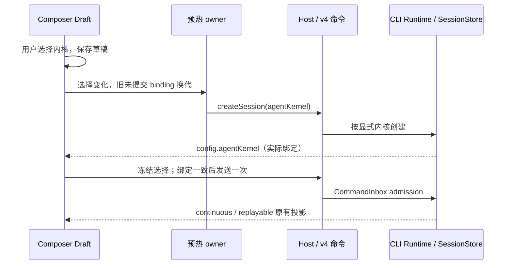

# 聊天输入框 Agent 内核选择

## Feature Summary

| 字段           | 决定                                                                          |
| -------------- | ----------------------------------------------------------------------------- |
| 用户意图       | 删除设置页内核切换，在输入框右下角直接选择 ZCode / Claude                     |
| 范围           | presentation、draft-default、validation、commit-effect、persistence、recovery |
| 唯一选择 owner | workspace identity/session scope 的 Composer Draft                            |
| 权威 owner     | CLI Runtime / SessionStore.agent_kernel；config.agentKernel 为只读投影        |
| 创建路径       | v4 createSession.agentKernel → createSessionRecord → 原生会话创建             |
| 旧设置         | 仅兼容读旧配置，聊天创建不隐式依赖 AppSettings.agentKernel                    |
| 不包含         | 历史内核迁移、SDK 登录型连接、新增手机 Host 或 Agent、模型配置重构            |

## 已确认边界

用户要求把选择放到聊天输入框。现有契约要求历史会话保留内核绑定，因此选择不同内核时创建独立会话，保留未提交正文、模型/模式、附件；不自动发送。运行、排队、等待审批时不换内核；同一内核选择为 no-op。Claude 连接不兼容或资源缺失必须可见报错，不能改用 ZCode。SDK 原生协议连接由适配器统一管理，可通过模型桥把主代理及子代理的显式选择路由到各自合法 Provider；无效模型仍明确报错，不能忽略配置或更换内核。无效的显式子代理模型配置必须指出子代理名称和原因，不能误报为主模型错误或改写用户模型配置。

新草稿选择默认 zcode，读取自身持久草稿选择。已有会话显示 snapshot.config.agentKernel，历史缺省为 zcode，不能根据设置或用户草稿声称真实内核。首发冻结选择；预热绑定只有与冻结内核一致时才能提升。切换草稿内核使预热 owner 换代，旧创建 ACK 到达后只清理旧会话；未确认的输入不得自动迁移或重发。附件沿用既有上传 owner，在新会话重新绑定上传，不能沿用旧会话附件 ref。队列撤回中已归 Session 的附件不在输入框迁移，选择器禁用并提示先移除这些附件。新 Agent 的 create ACK 附带实际绑定；不同内核创建的正式会话使用 `persistence=immediate`，即使还没发送也能冷恢复并找回草稿；预热继续使用 deferred。列表摘要以 Runtime 的实际持久化事实提供 `persisted`，因此 `phase=draft && persisted=true` 的显式新会话也进入任务列表；未持久化的预热仍隐藏。不伪造已完成轮次来提升列表可见性。显式 Claude 未得到确认时保留草稿、拒绝发送，不能被旧远端剥离字段后静默退回 ZCode。

## UI Surface Matrix

| 场景/入口                       | 显示/草稿                        | 提交                           | 权威与隔离                     |
| ------------------------------- | -------------------------------- | ------------------------------ | ------------------------------ |
| Desktop/Web/mobile 输入框右下角 | 已注册内核菜单，共用组件与本地化 | 草稿更新或独立会话创建         | workspaceKey；保留平台布局     |
| 已有会话                        | 显示绑定内核                     | 不同选择创建独立会话，不自动发 | 原会话、队列、原生 ID 不修改   |
| 新草稿/预热                     | Composer Draft                   | 显式 createSession.agentKernel | 预热迟到回包不得覆盖新选择     |
| 设置                            | 无聊天内核切换控件               | 仅选择提示词编辑/预览目标      | 各内核正文独立、扩展只读       |
| 系统提示词查询                  | 会话绑定优先                     | 原只读接口                     | 不把 ZCode 正文冒充原生 preset |

## 共享与差异、影响关系

| 分级           | 路径                                                                  | 原因                                        |
| -------------- | --------------------------------------------------------------------- | ------------------------------------------- |
| must-inspect   | ConversationComposer → useDraftConfigControl → useDraftSessionPrewarm | 选择、冻结、迟到 ACK 与附件绑定             |
| must-inspect   | v4 command schema → session-mgmt → v4-bridge → createSession          | 已确认旧设置只接另一条创建接口，v4 丢失内核 |
| must-inspect   | SessionConfigState / config projector                                 | 显示必须来自实际 Runtime                    |
| should-inspect | Settings / SystemPrompt inspection                                    | 删除旧入口与旧默认值引用                    |
| invariant-only | owner/lease、CommandInbox、desktop-continuous、web-remote-replayable  | 保持既有串行 admission 和恢复路径           |
| evidence-only  | 原生 SDK 测试、composer/prewarm 回归、桌面 E2E                        | 验证创建参数与执行内核，不能只检查 UI 文案  |

## Codegraph 与图谱

tokensave_context 找到 v4 session-mgmt.createSession（function:341103d6d2c2a11e9d104d4cf04cf9bb）；沿创建 host 钩子检查到 v4-bridge。原内核设置不在功能图中，属于 graph drift；补充聊天内核能力、surface、草稿 owner 与 v4 创建边。相关代码以当前工作树为准，静态索引不证明执行内核。

## 维度、剪枝与验收

主维度：草稿/预热/已完成/运行中；zcode/claude；本地/远程 identity；首次创建/冷恢复/迟到 ACK。主题与语言复用现有组件，不与模型、平台做全笛卡尔积。运行或待审批换内核剪枝为禁用；原生历史跨内核迁移不属于本次需求。

| Case    | Setup → Action                                    | Assertions                                                                                                        | 证据                    |
| ------- | ------------------------------------------------- | ----------------------------------------------------------------------------------------------------------------- | ----------------------- |
| KER-C01 | 无设置内核入口；新草稿选择 Claude                 | 右下角显示选择；createSession payload、Runtime、snapshot 都为 claude                                              | UI + protocol + Runtime |
| KER-C02 | 已预热 ZCode → 选择 Claude                        | 回收旧未提交会话，新预热为 Claude；旧 ACK 不绑定；首发只执行一次                                                  | controller + CLI        |
| KER-C03 | Claude 已完成，会话有未提交正文/附件 → 选择 ZCode | 独立会话立即持久化且绑定 zcode；草稿保留，附件重绑定；旧会话不修改且不自动发送；Session-owned queue refs 禁用切换 | UI + protocol           |
| KER-C04 | 运行/排队/待审批                                  | 控件禁用，不创建或修改会话                                                                                        | focused UI              |
| KER-C05 | 冷恢复 zcode / claude；旧草稿/快照无字段          | 显示与实际绑定相同；旧字段 fallback zcode                                                                         | snapshot + persistence  |
| KER-C06 | 相同路径但不同远程 identity                       | 草稿与预热独立；同 Host attachment，沿用 delivery kind                                                            | controller + protocol   |
| KER-C07 | Claude 连接不支持、资源缺失或旧 Agent 未确认内核  | 显示原错误；未接纳草稿保留，已接纳输入保留在历史；不能改用 ZCode                                                  | adapter + admission     |

## E2E Handoff

正式 E2E 使用 prepareV4ConversationE2E 与现有本地 provider fixture，选择器检查必须配合 Runtime/config 证据。设置页的旧交互用例由聊天入口用例替换；会话 catalog 与 coverage matrix 同步。SDK 真实供应商遵从率不属于控件验收。

## 发行 Agent 的 SDK 初始化

Desktop/remote 的 Agent 是 CommonJS bundle。Claude SDK 的 ESM 依赖使用 `createRequire(import.meta.url)`，构建必须提供当前 bundle 的真实 file URL，不能让 esbuild 将其置为空；SDK 可执行资源仍只来自应用资源路径或 SEA 的随包资源。验证必须加载真实 SDK 的 CJS bundle，隔离到无源依赖的目录，并经过桌面创建 Claude 会话，不以注入的 native port 测试代替发行形态。

## 验证记录

新的可扩展内核、按内核正文和协议桥验证记录见 [内核扩展](../agent-kernel-extension.md)。以下记录为聊天选择器首次接入阶段的验证范围。

- 279 项回归通过：根目录 210 项，CLI 53 项，CLI/CJS 构建 16 项。包含草稿内核存储、冻结提交、预热迟到 ACK、附件重新上传、立即持久化与列表可见性、两种 delivery 下的 v4 Runtime/SDK 绑定及冷恢复。
- 3 项桌面 E2E 通过：右下角选择与设置入口删除；预热与历史会话换代、正文/附件保留、原会话重新打开；从输入框首发由真实随包 SDK 返回 `AK_NATIVE_OK` 并收口；ZCode 运行时禁用选择。
- 首次接入阶段使用 Anthropic 夹具且关闭了固定账号模型的文档插件；当前已修复官方默认模型并在插件开启、OpenAI 协议的桌面回归中验证，详见扩展文档。
- 无效子代理配置错误携带子代理名称及原始原因。SDK 使用一份连接；跨 Provider 选型可经桥路由，保留每个显式选择的真实上游。
- 根目录 `pnpm typecheck`、`pnpm lint`（63 warnings / 0 errors）、`pnpm architecture:check --changed` 通过。CLI contracts/adapters/core/bootstrap 类型检查通过，CJS 回归通过。
- CLI 包级 `pnpm lint` 仍失败，触发的检查为 `eslint(max-lines)`，包括 contracts/model、bootstrap/v4-gateway、product-projection、adapters/storage 等超 400 行的文件；构建产生的 CLI `.js` 也在检查范围内。未将这项写为通过。
- 本轮未提交代码，未生成新的 macOS 安装包。
