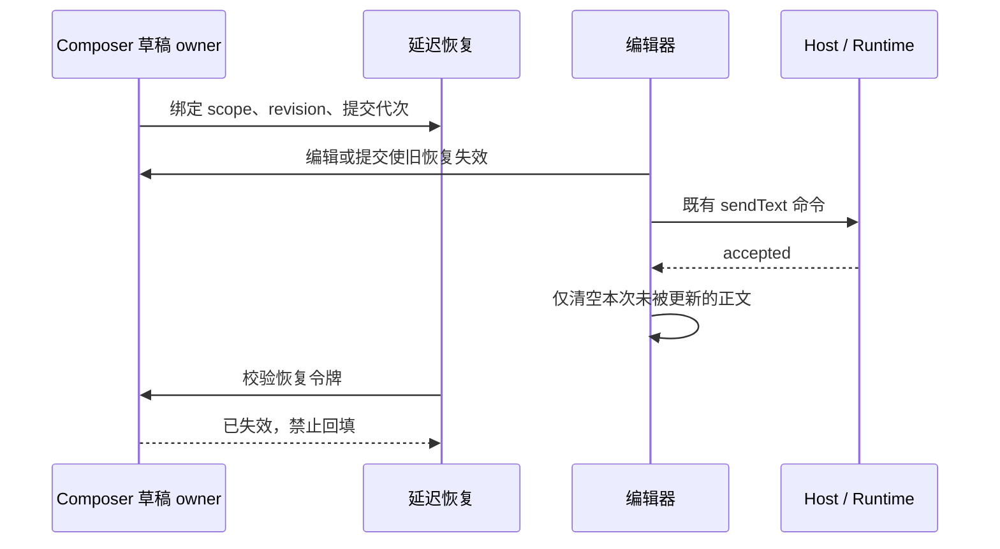

# Task-scoped composer drafts

## 背景

聊天输入框的未发送状态必须跟随 task 隔离，而不是跟随当前组件实例。用户在 A task 输入文本、添加附件或上下文 chip 后切到 B task，再切回 A task，应看到 A 自己的草稿；B task 也同理。

## 缓存边界

- workspace 隔离使用 `workspaceKey = workspaceIdentity?.trim() || workspacePath`。
- 草稿作用域使用 `taskId`；新建任务态使用 `null`，在 store 中映射为 `__draft__`。
- 每个作用域缓存完整 composer draft：文本、普通附件、code comment、web element context 和本地 revision。
- 桌面端恢复时优先重放 Lexical editor JSON 快照，保留 mention / token 节点；旧草稿或快照缺失时回退到纯文本恢复。
- focus、拖拽高亮、提示词增强 loading 等瞬时 UI 状态不进入草稿缓存。

## 持久化规则

- 当前 renderer 内存里按 workspace/task 独立保存，切换 task、卸载、页面隐藏、queued prompt edit、首发 task promotion 都要保存/恢复。
- 输入热路径只更新本地 composer state 和 revision，不按每个字符写全局 store/localStorage；完整草稿只在切换 task、卸载/隐藏、prefill/queued edit、首发 promotion、发送失败/成功边界保存或清理，避免大附件和长文本造成高频重渲染或持久化写入。
- 桌面端重启恢复使用 localStorage 的小型 JSON 缓存；key 中必须包含 workspace key，避免远程 workspace 同路径串线。
- 普通附件只持久化可恢复引用：带 `localPath` 的文件附件可以恢复；没有可恢复路径的浏览器 `File` 不复制到应用存储，重启后丢弃并提示用户重新添加。
- task 删除或发送成功后清理对应草稿，避免旧附件引用继续出现在后续会话。

## 延迟恢复与提交边界

- Composer 正文由已有草稿 owner 保存；延迟恢复只在挂载或 workspace/session scope 改变时发生。配置水合、回调引用变化、模型切换不能触发同 scope 的正文重放。
- 每个恢复任务绑定目标 scope、创建时的正文 revision 与提交代次。用户编辑、开始一次有效提交或离开目标后，旧任务失效；不能在 accepted 清空后重新填回已发送正文。
- ACK 只清理本次提交的正文；等待期间的新正文（包括改过再改回原文）保留。拒绝、失败和待确认继续沿既有草稿恢复路径，不复制 accepted queue。
- Desktop continuous 与 Web remote replayable 共用这套 renderer 草稿规则；Host/Runtime 仍是已接受输入的唯一所有者，恢复任务不发送或重放命令。

验收：同 scope 回调换代不重放；旧恢复晚于 accepted 不回填；恢复前的新输入不被覆盖；发送失败可重试；scope 切换正确恢复目标；ZCode/Claude 的真实编辑器首发与后续发送均保持清空。

2026-10-15 验证：新增四项可控帧竞态测试先红后绿；178 项 UI/草稿/图领域回归及 26 项 CLI 集成回归通过。三个桌面 E2E 通过，包含 ZCode 首发、重新打开原会话、Claude 同会话连续两次发送后正文持续为空。第一次桌面扩展测试因回放夹具只允许一次模型响应而失败，补齐第二次响应后通过；未修改产品超时。根目录 typecheck/lint/architecture、CLI core/bootstrap typecheck 通过，Lint 为 63 warnings、0 errors。
