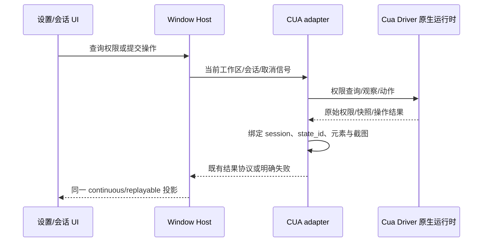
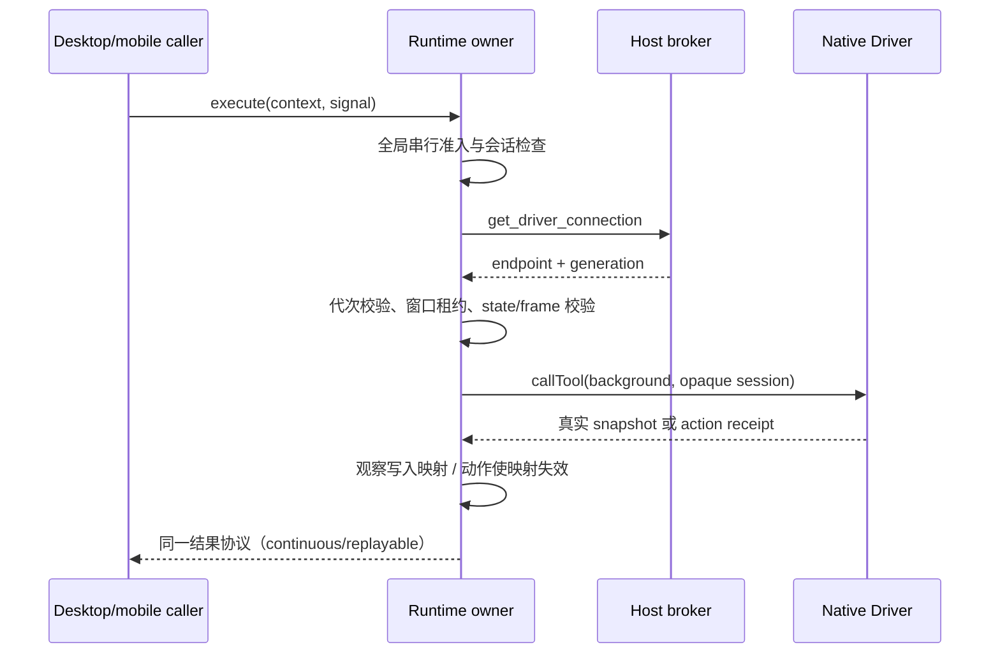

## 职责

电脑操作使用固定版本 Cua Driver 0.36.0，替换原占位执行层。保留 Node REPL 的 agent.computerUse 入口、既有工具结果协议、workspace/session 隔离和取消；不引入第二个 Agent 循环。驱动会话、快照与元素 token 映射由本模块唯一持有。截图尺寸与坐标绑定当前快照，旧代次不执行动作，不伪造权限或操作成功。

macOS arm64、Windows x64、Linux x64 使用同一固定 Driver 发行与适配层；Windows/Linux 直接运行随包可执行文件，macOS 使用独立 app。平台缺少原生资产或系统层不支持后台投递时明确报错，或按驱动建议升级，不能显示为已就绪。前台动作必须使用明确目标。

## 边界

Main 负责原生权限入口和进程调度；Window Host 保留工作区和会话路由，UI 经现有 services/hooks 访问，不直接加载原生库。驱动执行只通过本模块接口，desktop-continuous 与 web-remote-replayable 复用同一运行时和状态，不为手机另起控制者。取消或停止会话清理快照和输入资源，退出释放 native handle。

macOS 使用随产品固定分发的独立 CuaDriver.app 作为权限主体，经 LaunchServices 按需启动；不连接全局旧版本或回退到 Host 内嵌执行。Main 既有拖拽授权引导指向经过校验的实际 Driver app。Window Host 维护逻辑兼容 socket，只做状态查询、原生连接代次发现及进程调度；Agent SDK 直接连接原生 endpoint 执行工具，重启使旧代次快照失效。首次设置查询与首次工具请求显式进入同一宿主创建路径，地址解析保持纯函数。

权限来自实际执行进程或驱动明确报告的授权宿主。状态结果区分不可用、未授权、已授权与实际探针就绪；成功返回与可用性判据一致。授权只在用户点击时请求；普通状态查询不打开系统提示。安装包使用固定原生资产与校验值，资源位于 ASAR 外；驱动库保持运行时外置，避免 CommonJS/原生加载破坏 Electron ESM。

Host 的启动、健康查询、状态读取与重启由同一串行准入持有；重复启动合并，stop 先关闭准入并取消在途请求，排空后释放客户端和进程。每个原生代次使用独立 socket 与 pid 文件；清理前核对实际进程可执行路径与该代次启动参数，旧结果不得停止替代代次。兼容 socket 生命周期覆盖原生重启，连接描述含 SDK 绝对路径，Agent 不依赖仓库 node_modules。

Cua Driver 遥测和独立自动更新显式关闭，随 ZCode 发行固定升级。保留第三方许可及摘要。已有 PiP/虚拟光标只有在底层实际支持时才报告能力，不能把空实现作为完成。

## Runtime adapter 契约

`createComputerUseRuntime` 保留原 API 与 14 个工具。SDK 仅懒加载并连接 Host 提供的 native endpoint；每次准入经稳定 broker 查询 `{socketPath,generation,pid}`，代次改变时释放旧客户端、清空快照和元素映射，动作必须重新观察。显式 `ZCODE_CUA_DRIVER_SOCKET_PATH` 仅用于开发与测试。会话标签由 workspace identity/key、session、scope、remote session 经带随机密钥的摘要生成，不向 Driver 暴露用户身份。

运行时是 state/frame/token 的唯一所有者，模块级串行准入与窗口控制租约防止多个控制者覆盖映射。内部 observation/actions helper 复用同一会话状态与调用入口，不新增状态所有者。应用与窗口均由真实 inventory 唯一解析；重复应用或多个无明确主窗口的窗口必须由调用方选择，已安装的唯一应用可后台启动。`list_apps` 保留原生空名称并允许按 pid 或 bundle id 解析；`list_windows` 将真实 bounds 转成旧接口的 `[x,y,width,height]`，仅在 Driver 明确提供时映射 `main`、`focused`，不由顺序或 active 推断。观察同时请求实际 `snapshot_id`、结构化元素和树文本；公开元素保留原始索引位置，动作只使用真实 `element_token`。state/frame 同时绑定会话、应用、窗口和驱动代次；动作后失效，`return_state` 重新观察实际结果。原生 advertised action 的可选 `AX` 前缀在匹配时规范化，例如 `AXShowMenu` 与 `Show Menu` 对应同一受支持动作。

截图仅在返回真实 capture id、栅格宽高与可验证几何时签发 frame。坐标为该栅格范围内的整数，按 Driver 窗口截图像素契约原样投递；禁止用全局 bounds 或元素中心伪造目标。Native click 使用 capture id 校验；无 capture id 支持的坐标动作须先验证当前快照身份。后台文本/按键先走 AX 写入；网页内容被驱动拒绝时，用当前快照的 `screenshot_frame` 做后台像素聚焦后再输入（不抢焦点），仍被系统层拒绝时按驱动的显式建议升级为短暂前台并恢复原前台，可用 `ZCODE_CUA_FOREGROUND_ESCALATION=never` 禁用。无法保持 a11y/event 路由、选区、富文本剪贴板语义时明确 `action_unavailable`。

取消在投递前返回 `action_sent:false`，投递后保留 `possibly_sent` 或 Driver 明确完成收据，绝不自动重放。关闭先禁止准入并 abort 在途，再结束本地 native session、清理映射；dispose 只释放客户端及 UniFFI handle，不停止 Host daemon。权限请求只查询 `check_permissions({prompt:false,probe_direct_capture:false})`，缺权限返回结构化状态，系统授权由 UI 的用户点击路径触发。权限归属优先采用 Driver 报告的 `source.bundle_id`，为空时采用 `source.host_bundle_id`；desktop-continuous 与 web-remote-replayable 使用同一结果协议。

## 验收

- 固定 SDK 和原生资产在真实 Electron 41 下加载；不触发模型请求。
- 真实查询权限、枚举应用和窗口；在隔离测试窗口完成截图、AX 元素读取、点击/输入后读回。
- 覆盖权限未授予、运行时缺失、取消、stale state、跨 workspace/session token 与清理。
- 设置区分驱动未就绪与权限未授予，授权后刷新使用同一宿主。
- 生产构建可解析原生库和驱动可执行文件；类型、Lint、架构和定向测试实际执行。
